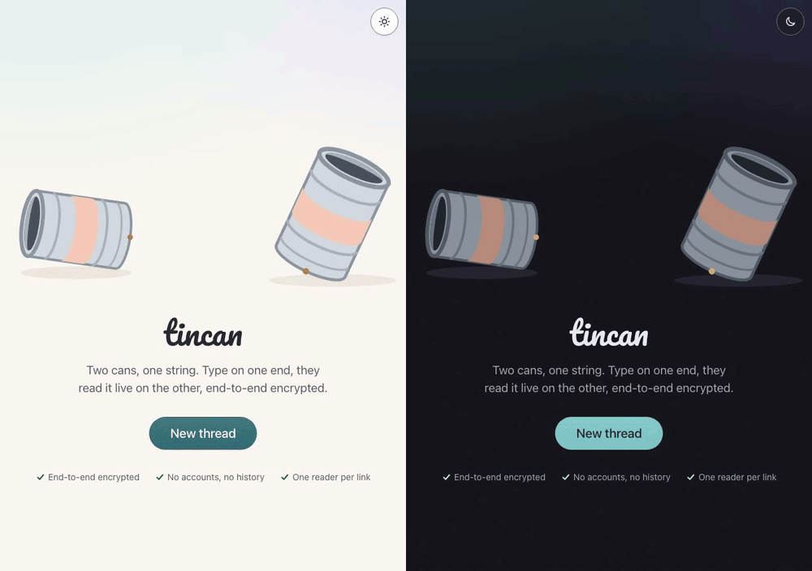
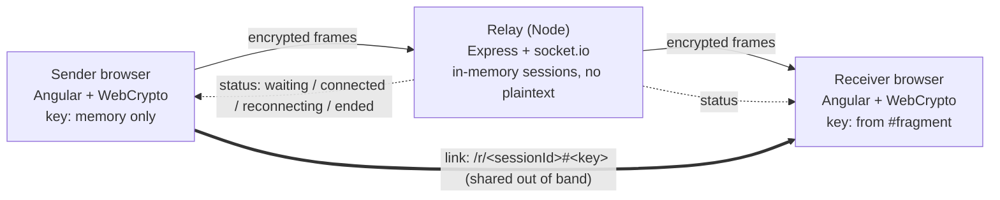

# tincan

> Two cans, one string. Live, end-to-end encrypted text from one sender to one receiver.

tincan shares a live-updating text from **one sender** to **exactly one receiver** through **one link**. The text
is encrypted in the sender's browser and decrypted in the receiver's browser (AES-256-GCM, WebCrypto). The key
travels in the link's `#fragment`, which browsers never send to a server, so the relay in the middle only ever
forwards ciphertext. No accounts, no history: when either side leaves, the line is cut.

Why: sometimes you want to dictate something to one person, live, without a chat service keeping a copy and without
either of you installing anything. tincan is a small, readable reference for doing that in a browser, with the
security model written down.



*Sender on the left (light theme), receiver on the right (dark theme). The session shown is a throwaway on a local
server and is cut on screen, so the key visible in the link is dead.*

**Contents:** [Quick start](#quick-start) · [How it works](#how-it-works) · [Security model](#security-model) ·
[Tests](#tests) · [Limitations and future work](#known-limitations-and-future-work) ·
[How the project is run](#how-the-project-is-run) · [AI usage](#ai-usage)

## Quick start

Requires **Node 24 LTS** (`.nvmrc` pins `24.22`; `engines` allows `^22.22.3 || ^24.15.0 || >=26`) and npm.

```bash
npm install                        # installs every workspace and builds shared/
npm start                          # builds, then serves the app and the relay on http://localhost:3000
```

Open <http://localhost:3000>, click **New thread**, send the link to the receiver (or open it in another browser
profile), click **Join**. The receiver clicks **Pick up**; whatever you type appears on their screen.
Set `PORT` to use another port. For TLS and reverse-proxy notes see
[Deployment notes](docs/security.md#deployment-notes).

Development (hot reload):

```bash
npm run dev    # shared (tsc watch) + relay on :3000 (tsx watch) + Angular on :4200 (proxies /socket.io)
```

Open <http://localhost:4200>. Do not set `PORT` for `npm run dev`, because `ng serve` reads it too.
The full command list is in [AGENTS.md](AGENTS.md#commands).

## How it works



1. The sender's browser generates a 256-bit key and imports it as a **non-extractable** `CryptoKey`; the relay
   answers with a random session id and a sender token.
2. The link is `https://host/r/<sessionId>#<key>`. The receiver must click **Pick up** (so link previewers cannot
   burn the single receiver slot); the page then reads the key, clears the fragment from the address bar and joins.
   The first receiver locks the session; a second one sees "This line is busy".
3. Every keystroke burst is sent as a **full-state frame** (debounced 300 ms, at most 1 s while typing), padded to a
   size bucket, encrypted and relayed. Encrypted `typing` and heartbeat frames look identical to text on the wire.
4. A reload, close or **Cut the line** ends the session for both sides; a network blip gets a 20 s grace and resumes.

| Package | What |
|---|---|
| `shared/` | Wire protocol: event names, payload types, limits, strict runtime validators, AAD builder |
| `client/` | Angular app: crypto module, relay client, sender and receiver views, design system |
| `server/` | Express + socket.io relay; serves the built client with strict security headers |
| `e2e/` | Playwright end-to-end tests and the demo recorder |

Details (wire protocol, frame format, padding, lifecycle, limits): [docs/architecture.md](docs/architecture.md).
Design language: [docs/design.md](docs/design.md). Decisions: [docs/decisions/](docs/decisions/README.md).

## Security model

The relay is treated as **honest-but-curious at best and malicious at worst**: it must learn nothing but metadata,
and anything it tampers with must be visible to the receiver.

- **Key in the URL fragment.** Fragments are never sent in HTTP requests; the receiver clears it with
  `history.replaceState` before even validating it, and `Referrer-Policy: no-referrer` is set
  ([ADR 0001](docs/decisions/0001-key-in-url-fragment.md)).
- **Non-extractable, memory-only key.** Imported as a non-extractable `CryptoKey` on both sides, raw bytes zeroed,
  never stored or logged. Reload ends the session ([ADR 0004](docs/decisions/0004-session-ends-on-reload.md)).
- **AES-256-GCM with AAD.** Fresh 96-bit IV per frame; the AAD `tincan/v1|<sessionId>|<seq>` binds every frame to
  its session and position, so the relay cannot splice, renumber, replay or reorder frames undetected.
- **The relay never sees plaintext.** It validates shapes, enforces one sender, one receiver and rate limits, and
  forwards ciphertext. It logs no ids, tokens or payloads.
- **Integrity warnings, never silent failure.** A tampered, replayed or cross-session frame is dropped, the last good
  text stays, and the receiver sees "Something tampered with the line." An encrypted heartbeat turns the view stale
  if the relay withholds frames.
- **Length hiding.** Plaintext is padded to size buckets ([ADR 0005](docs/decisions/0005-no-decoy-traffic.md)).
- **CSP and Trusted Types.** `default-src 'none'`, `script-src 'self'`, a per-response style nonce, Trusted Types
  required, no third-party scripts, fonts or images; decrypted text is only ever rendered through Angular text
  interpolation ([ADR 0006](docs/decisions/0006-csp-style-nonce.md)).
- **Lifecycle.** Reload, close, **Cut the line** and a 10-minute idle cut end the session for both sides at once; the
  relay has 15-minute and 2-hour backstops.

- **A leaked link can read, not forge.** Publishing needs the sender token, which never leaves the sender tab's
  memory and is not part of the link. Signing every frame (ECDSA) was evaluated and declined: it only helps against a
  relay that could just as well ship code that reads the key
  ([ADR 0009](docs/decisions/0009-signed-frames.md)).

Residual risks are written down, not hidden: a malicious server could ship malicious JavaScript (inherent to browser
E2E crypto), a leaked link leaks the conversation, the relay sees metadata (who, when, roughly how much), and one
client can fill the session table unless the proxy limits it.
Full threat model, controls table and residual risks: [docs/security.md](docs/security.md).

**Final security audit (T13).** Secret scanning (gitleaks, tree and history), dependency CVEs (trivy, `npm audit`),
SAST (semgrep), CI config (checkov), live header and relay-abuse probes and a browser pass over fragment handling and
XSS found **no Critical or High** issues. Fixed in that pass: the relay now accepts **WebSocket handshakes only**
(the unused long-polling transport let cross-site pages open engine.io sessions without an `Origin` header), a key
fragment that arrives **outside `/r`** (a mangled link) is dropped from the address bar and history, and Dependabot
waits a **seven-day cooldown** before proposing new versions. Accepted: **R-6**, session-table exhaustion by one
client, to be limited per address at the reverse proxy. Report:
[docs/security/audit-T13.md](docs/security/audit-T13.md).

## Tests

<!-- TODO(T19): update the counts below once the home-link button lands. -->
| Suite | Tool | Count (current `main`) |
|---|---|---|
| Unit: `shared/` (protocol, validators) | Vitest | 93 |
| Unit: `client/` (crypto, padding, relay, sessions, views) | Vitest + Angular | 297 |
| Unit: `server/` (relay, rate limits, headers) | Vitest | 112 |
| End-to-end (two real browser contexts against the production build) | Playwright | 33 |

```bash
npx playwright install chromium   # once
npm test                          # unit tests
npm run e2e                       # build, then Playwright (server on E2E_PORT, default 3100)
npm run verify                    # everything CI runs: lint, typecheck, unit, build, e2e
```

The e2e suite drives the real sender and receiver UIs and, through a WebSocket tap, proves the hard parts: ≥2
consecutive updates arrive exactly and in order, a flipped ciphertext byte or a replayed frame raises the integrity
warning without rolling back the text, a second receiver is refused, and no URL, header, body or WebSocket frame ever
contains the key or the plaintext. No fixed sleeps: every step waits on UI state.

Every task also gets a manual QA pass on the production build before its PR; the reports, with screenshots, are in
[docs/testing/](docs/testing/README.md).

### Regenerating the demo GIF

```bash
npx playwright install chromium   # once; ffmpeg must be on PATH (or set FFMPEG=/path/to/ffmpeg)
npm run demo:gif                  # builds, starts the production server on :3150, writes docs/media/demo.gif
```

`e2e/demo/record-demo.ts` records two 640x900 browser contexts (light and dark) with Playwright video, then ffmpeg
puts them side by side, trims and writes a palette-optimised GIF of at most 4 MB. It waits on UI state like the
tests; only the typing speed and short pauses are timed. It is not part of the test run.

## Known limitations and future work

- **Code delivery (R-1).** The server that relays frames also serves the JavaScript; a compromised server could ship
  code that steals the key. Mitigation would be a signed, installable client or subresource pinning.
- **Leaked link (R-2).** The key is in the link: anyone who has it can read a live session whose receiver slot is
  still free. Forging is blocked by the relay's sender token, not by cryptography; signed frames were declined
  ([ADR 0009](docs/decisions/0009-signed-frames.md)). The real upgrade is ECDH with a short authentication string, or
  a PAKE: no secret travels in the link, which fixes reading and forging together and adds forward secrecy.
- **Metadata (R-3).** The relay sees who connects, when, and roughly how much is typed (bucketed).
- **Session-table exhaustion (R-6).** Sessions are capped globally (10 000) and per socket, but not per address: one
  scripted client can hold sessions until new threads get `busy`. Availability only; put a per-address connection
  limit on the reverse proxy ([deployment notes](docs/security.md#deployment-notes)).
- **The link outlives the page (R-5).** Browser history and wherever the link was pasted keep it; a session only
  ends when a party leaves.
- **Single process, in memory.** Sessions live in one Node process; horizontal scaling would need sticky sessions or
  a shared registry. A restart ends every session.
- **Tested on Chromium.** Firefox and WebKit were not part of the automated or manual runs.
<!-- TODO(T19): mention the home-link button if it changes any flow above. -->

## How the project is run

The work is split into small tasks on a board, each one branch and one pull request:

- **Task board:** [docs/tasks/](docs/tasks/README.md), with dependencies, acceptance criteria and a log per task.
- **Workflow:** [docs/workflow.md](docs/workflow.md): `backlog → ready → in-progress → in-review → qa → pr-open →
  done`. Every branch gets a code review, a security review if it touches the security surface, and a QA pass in a
  real browser before its PR opens. CI runs `npm run verify`; `main` is protected and a human merges every PR.
- **Decisions:** [docs/decisions/](docs/decisions/README.md), nine ADRs (key in the fragment, full-state frames,
  relay stack, reload ends the session, padding over decoys, CSP style nonce, strict wire validation, QR library,
  no signed frames).
- **Roles:** [.claude/agents/](.claude/agents): product manager, senior developer, developer, QA tester, security
  pentester and designer, with a human maintainer who approves every merge.
- **Skills:** [.claude/skills/](.claude/skills): `task-workflow`, `pr-gate`, `crypto-review`, `security-audit`.
- **Conventions:** Conventional Commits, branches `<type>/<task-id>-<slug>`, TypeScript strict, English only.
  Start with [AGENTS.md](AGENTS.md).

## AI usage

tincan was built with AI agents doing most of the typing and a human maintainer making the calls and merging.

**Models and tools**

- **Claude Code** as the harness. The main session acts as orchestrator and launches one **subagent per role**
  ([.claude/agents/](.claude/agents)), each on the model its job needs ([CLAUDE.md](CLAUDE.md)):
  - **Claude Opus 5.5** for judgement-heavy roles: product manager, senior developer (architecture, crypto,
    protocol), security pentester, designer.
  - **Claude Sonnet 5.5** for well-scoped execution: developer and QA tester.
- **Git worktrees:** parallel tasks run in isolated worktrees, so agents never share a working tree.
- **Skills:** the project skills above, plus the built-in `/code-review` and `/security-review` in the PR gate.
- **Hooks:** local git hooks check every commit and commit message, and a Claude Code hook keeps an activity journal
  for the maintainer. Nobody bypasses them (`--no-verify` is forbidden).

**How the output was validated**

- **Tests first-class:** every behaviour ships with unit tests in the same commit; `npm run verify` must be green
  locally and in CI.
- **Independent reviews:** a different agent than the author reviews each branch (`/code-review`), and the security
  pentester reviews every change to crypto, protocol, server handlers, headers, URL or storage handling
  (`/security-review` plus the project's `crypto-review` checklist). Findings go back to the author and are logged in
  the task file.
- **QA on the production build:** the QA agent clicks through the golden paths and adversarial cases in real
  browser contexts before any PR, and commits a report with screenshots to [docs/testing/](docs/testing/README.md).
- **A human merges every PR.** Agents never merge, force-push `main` or skip hooks.

**Contributions that were caught and fixed** (evidence in the QA reports and task logs)

- **Escape race in Cut the line (T16).** QA found that pressing Escape right after "Cut the line" was lost in 3 of 5
  runs: focus only moved to "Keep talking" after the next render, so the group's key handler never fired, and the
  committed e2e spec was flaky under load. Fixed with a document-level Escape handler while the confirm is open,
  covered by unit tests and a stable e2e spec. [T16 report, defect 1](docs/testing/T16.md#defects).
- **3 px sideways scroll (T17).** QA measured that the sender's dimmed string overshot the viewport by 3 px at every
  width from 360 to 1920, so the page scrolled sideways. Fixed by making the tail edge-exact in every state and
  clipping `html` horizontally; `e2e/tests/string-edge.spec.ts` now asserts `scrollWidth <= innerWidth`.
  [T17 report, D1](docs/testing/T17.md#defects).
- **Circular QR test (T18).** The security review decoded the QR independently and noticed that the e2e test checked the QR code by re-encoding the
  link with the same library, which proves nothing. The test now screenshots the rendered SVG and decodes it with
  `jsQR` (e2e dev dependencies only). While applying the review the developer also found that non-ASCII text was
  passed to the library wrongly (it kept only the low byte of each UTF-16 unit), fixed by UTF-8 encoding first, with a
  unit test. [T18 report](docs/testing/T18.md),
  [T18 log](docs/tasks/T18-qr-code.md#log).

## License

[MIT](LICENSE)
