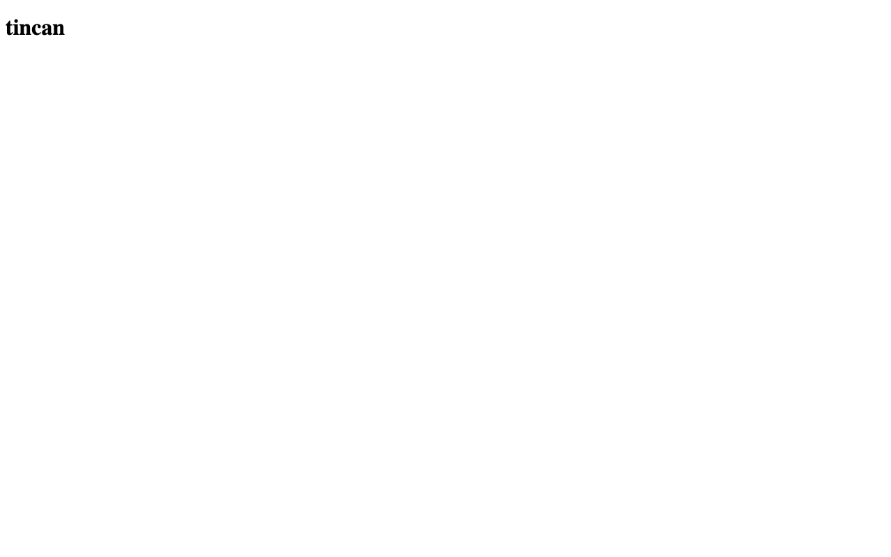
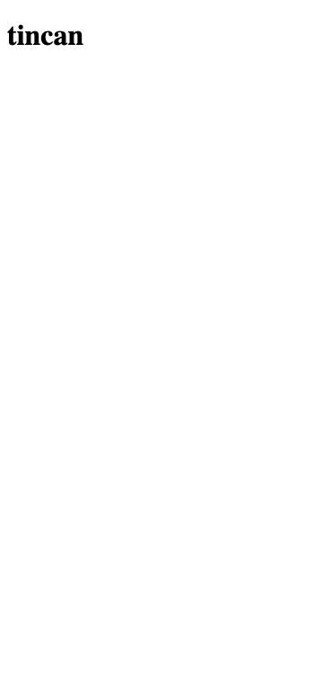
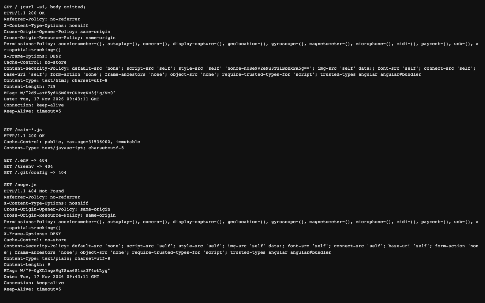
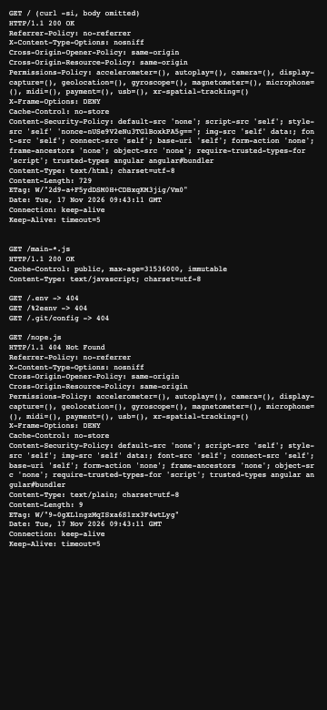
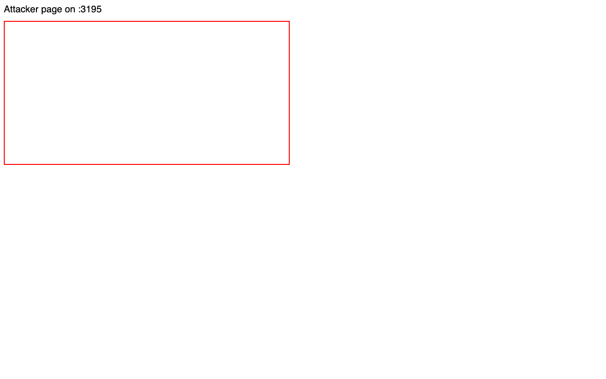
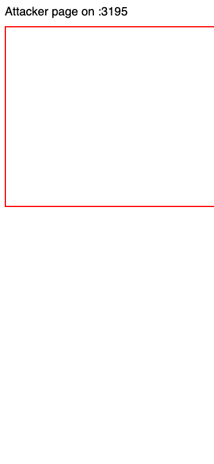

# T06 test report: Security headers and static serving

| Branch | Commit | Date | Tester | Result |
|---|---|---|---|---|
| `feat/T06-security-headers` | `a0a7d9a` | 2026-11-17 | qa-tester | PASS |

## Environment
Node 24.22.3, Chromium (Playwright, headless), production build served with `PORT=3194 npm run serve -w @tincan/server`,
curl for headers. Viewports: 1280x800 and 360x780. The cross-origin iframe host was a throwaway page on :3195.

## Flows
### 1. App renders under the CSP
Steps: load `/` and the deep link `/r/abc` at both viewports with a `securitypolicyviolation` listener and console/pageerror capture.
Expected: page renders, zero CSP violations, zero console or page errors.  Actual: 0 violations, 0 errors in all four loads.  Result: PASS

### 2. Response headers
Steps: `curl -si /` twice, plus `/r/abc`, a hashed bundle and `/nope.js`.
Expected: CSP (`default-src 'none'`, `script-src 'self'`, style nonce, Trusted Types, `frame-ancestors 'none'`, `base-uri 'self'`, `form-action 'none'`), `Cache-Control: no-store`, `nosniff`, `X-Frame-Options: DENY`, `Referrer-Policy: no-referrer`, COOP and CORP `same-origin`, Permissions-Policy, no `X-Powered-By`; nonce differs per request and matches the nonce in the HTML (`<link>`, `<script>`, `ngcspnonce`).
Actual: all present; nonces differed between two requests; `/r/abc` has the same policy; hashed `main-*.js` is `public, max-age=31536000, immutable`.  Result: PASS

### 3. Cross-origin iframe
Steps: page on `http://localhost:3195` embeds `http://localhost:3194/`.
Expected: blocked.  Actual: frame became an error page, console reported a `frame-ancestors 'none'` violation.  Result: PASS

## Edge and adversarial checks
| Check | Expected | Result |
|---|---|---|
| `GET /.env` | 404 | PASS (404) |
| `GET /%2eenv` | 404 | PASS (404) |
| `GET /.git/config` | 404 | PASS (404) |
| 404 page (`/nope.js`, `/.env`) headers | base headers still present, `no-store` | PASS |
| Nonce uniqueness | differs between two requests | PASS |

## Automated
Not re-run by QA (`npm run verify` is the dev gate); the production build succeeded.

## Not covered / follow-ups
HSTS only appears over HTTPS or `X-Forwarded-Proto: https`, not exercised here (covered by `server/test/headers.spec.ts`). The client is still the T01 placeholder, so no interactive flows exist yet.
