# T08 test report: Sender view

| Branch | Commit | Date | Tester | Result |
|---|---|---|---|---|
| `feat/T08-sender-view` | `d640d5e` | 2026-11-17 | qa-tester | PASS |

## Environment
Node 24.22.3, Chromium (Playwright), production build (`npm run build`) served by `node server/dist/index.js` on :3218, real CSP. The sender browser reached the server through a small TCP proxy (:3228) that can reset all connections and refuse new ones. There is no receiver UI on this branch, so the receiver was a socket.io client in Node that joined the session id from the link and decrypted frames with the key from the fragment (AES-256-GCM, AAD `tincan/v1|<id>|<seq>`, padding stripped). Viewports 1280x800 and 360x780, light and dark. Throwaway scripts were kept outside the repo. 56 checks, 54 passed; the 2 reported failures are explained below (one test-regex error, one fake-clock artifact) and are not product bugs.

## Flows
### 1. Home, New thread, dialog, Join
Steps: open `/`, click New thread, read the dialog, click Copy, join as receiver, click Join.
Expected: dialog with link `<origin>/r/<id>#<key>`, copy button, private-sharing hint; Join goes to `/s`.
Actual: link format matched; copy put the exact link on the clipboard and the label changed to "Link copied"; hint reads "Send it over a channel you trust"; Join opened `/s` with no key in URL or title. Result: PASS
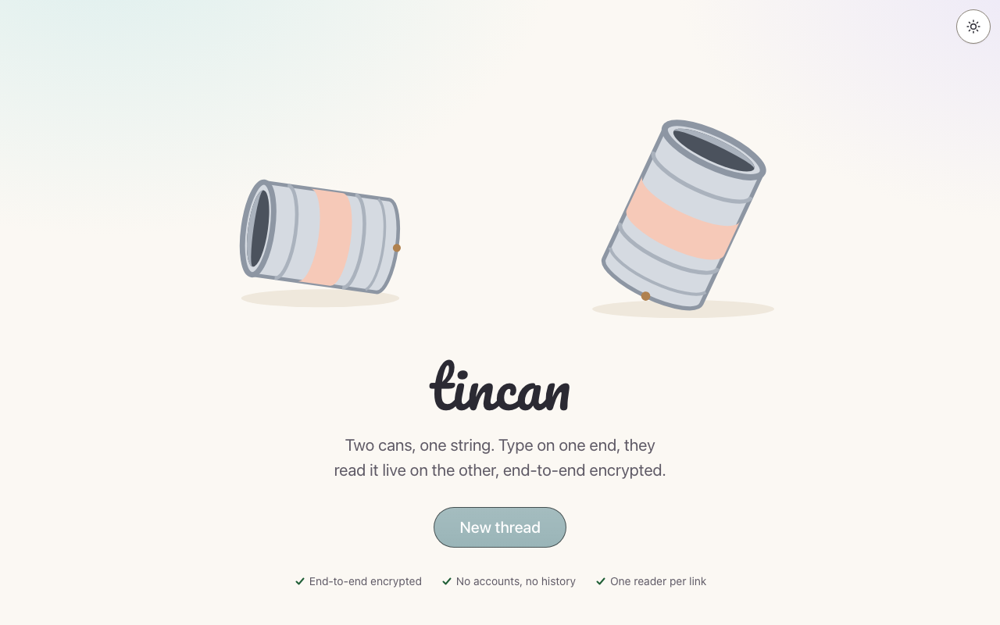
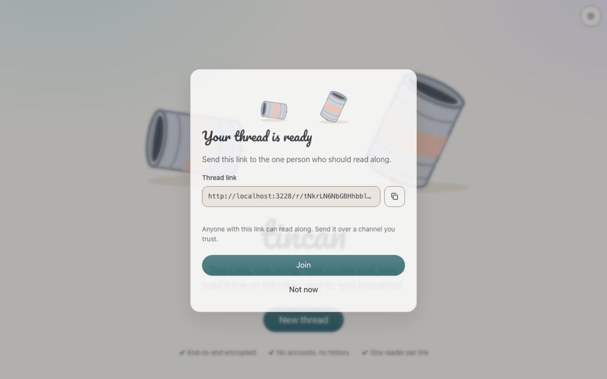
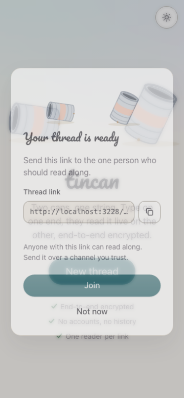
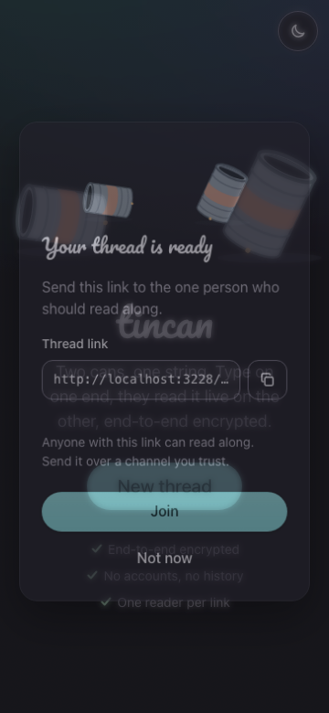

### 2. Writing and frames
Steps: type 37 characters at 50 ms per key (2.6 s), pause, type more; idle 16 s.
Expected: decrypted full-state text; debounced; typing at most about 1/s; beat about 5 s.
Actual: 3 text frames for the burst (lengths 0, 20, 37, gaps 1602 and 1041 ms), 2 typing frames in 2.6 s, last text equals the full state, the second update arrived in order with the full text, all seqs increasing, 0 decrypt errors, 3 beats in 16 s with gaps 5001 and 5003 ms. Result: PASS
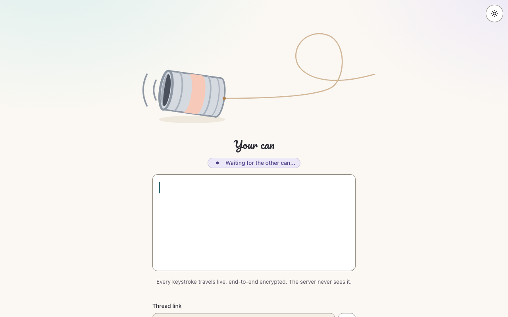
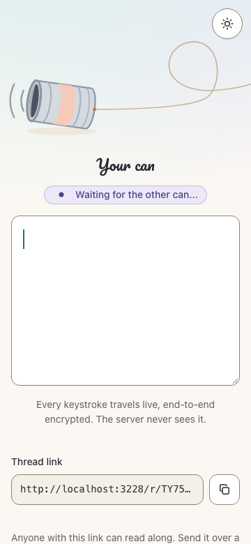
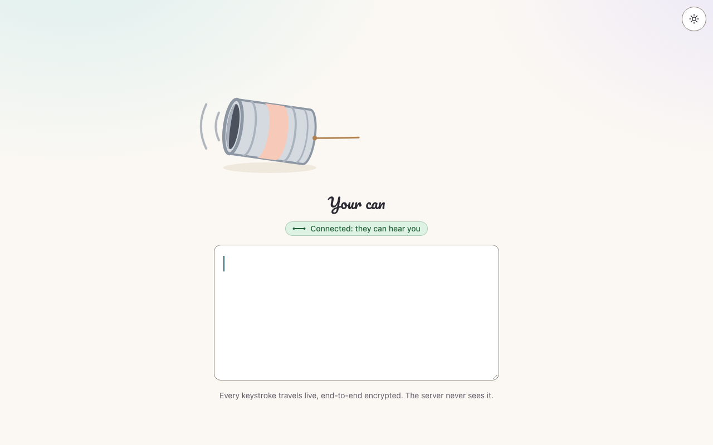
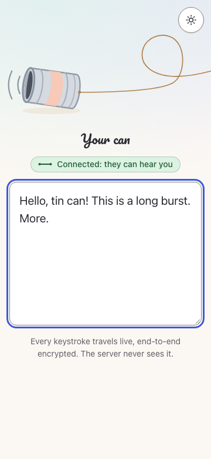
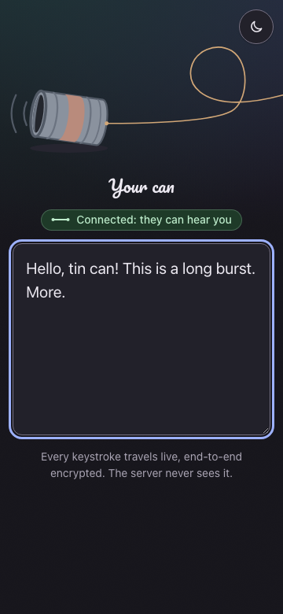
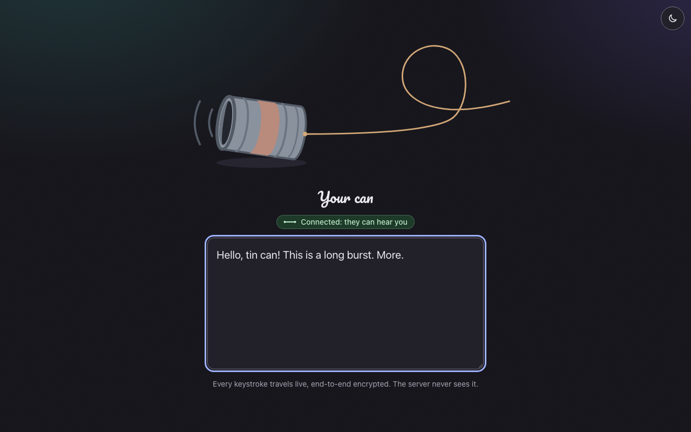

### 3. Not now, Escape, direct /s
Expected: both end the session; receiver sees ended; `/s` without session goes home.
Actual: receiver got peer `gone` then `peer_left` for both; the id was no longer joinable (`not_found`); `/s` redirected to `/`; so did a reload on `/s`. Result: PASS

### 4. Late joiner
Text typed before the receiver joined was delivered 10 ms after the join. Result: PASS

### 5. Reconnect
Steps: reset the sender's TCP connections and refuse new ones; type three texts while offline; restore.
Actual: sender pill "Line is slack, reconnecting...", receiver got peer `reconnecting`, textarea stayed editable, nothing delivered while offline; after resume the sender showed connected and the receiver got only the latest text ("offline three LATEST", delivered twice, see follow-ups), never the intermediate ones. With the link kept down over 20 s the sender ended and the receiver got `peer_timeout`. Result: PASS
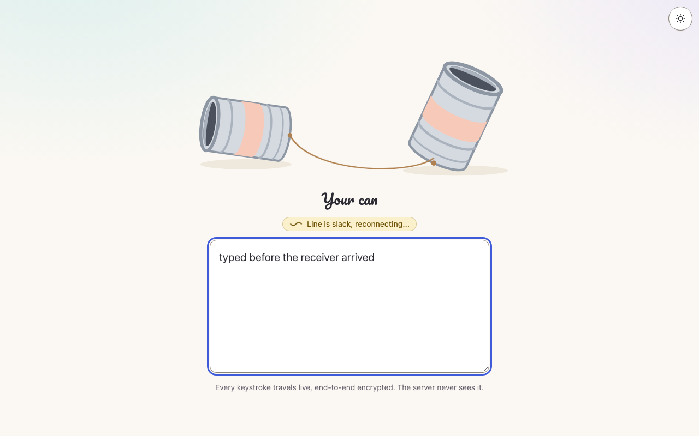
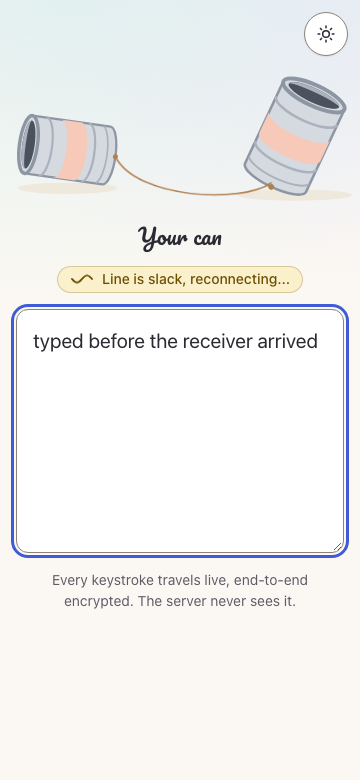
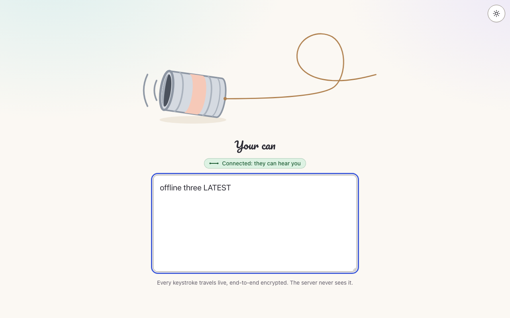

### 6. Ended
Receiver left: sender pill "Line cut", textarea read-only, "The line is cut" banner. Result: PASS
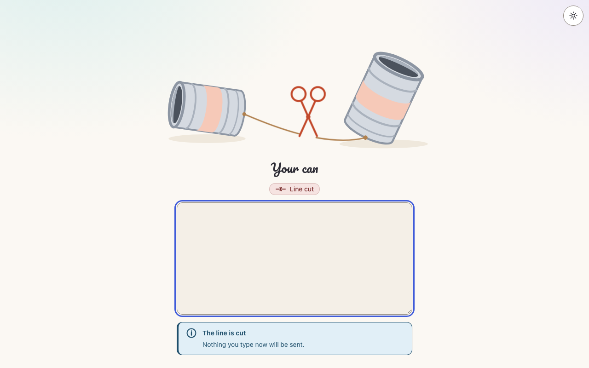
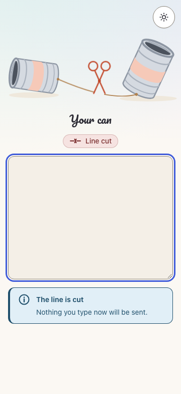

### 7. Idle (Playwright `page.clock`)
No warning at 8:50; warning at about 9:05 with a countdown (0:54); "Keep the line open" cleared it; the warning came again 9 min later (clock reset); at 10 min the sender ended ("The line is cut"). Result: PASS
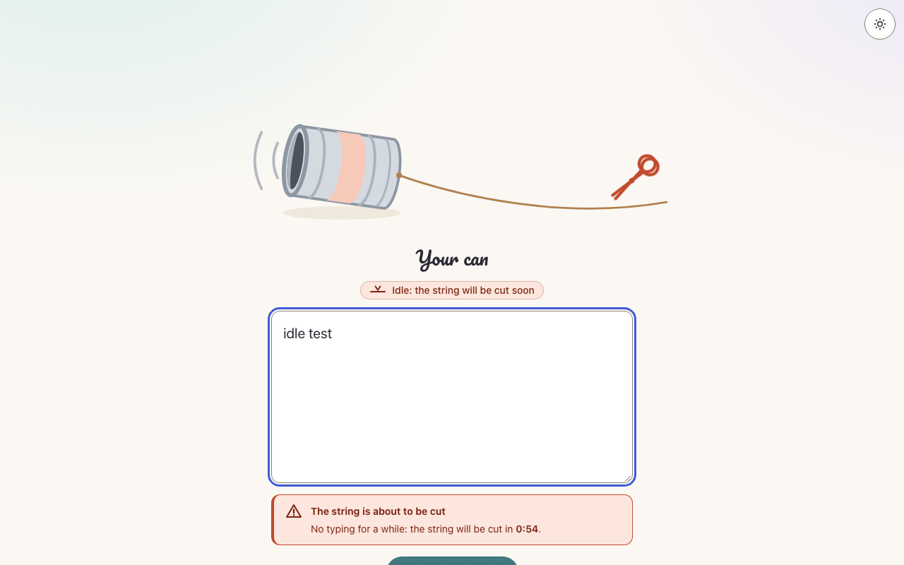
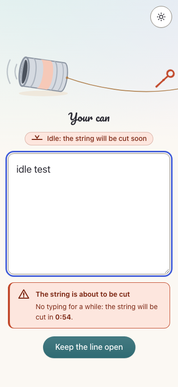

## Edge and adversarial checks
| Check | Expected | Result |
|---|---|---|
| Key in any request URL/header/body, WebSocket frame (54), console, storage, history, cookie, title, page URL (91 haystacks) | none | PASS |
| Plaintext in WebSocket frames | none | PASS |
| `fill` 12 000 chars, and `insertText` 12 000 chars | textarea 10 000, receiver at most 10 000 | PASS (10 000 / 10 000) |
| RTL, emoji with ZWJ, HTML, quotes, backslash, NUL | round-trips exactly | PASS |
| Empty text | delivered | PASS |
| Layout 360 and 1280, light and dark | no horizontal overflow | PASS |
| CSP violations, console errors and warnings | none | PASS |
| Reload of sender | goes home; receiver sees `reconnecting`, then `gone` / `peer_timeout` after the 20 s grace | PASS (known, task Log) |

Explained non-passes of the harness: the privacy-hint check used a wrong regex (the hint is present, see flow 1). With `page.clock.fastForward` the browser's socket.io ping timers fire early, so the page was "reconnecting" underneath and the idle cut did not reach the receiver as `peer_left` in that run; the sender-side cut at 10 min worked. The explicit leave on idle cut is covered by the unit tests (`sender-session.spec.ts`), not by this run.

## Automated
`npm run verify` was not re-run by QA (dev and security reported green).

## Not covered / follow-ups
- After a resume the latest text was delivered twice (queued frame plus the peer-rejoin resend); harmless, same text, but one redundant frame.
- 06-writing-dark-1280.png is about 340 KB, slightly above the 300 KB guideline.
- Keyboard-only walkthrough was not done beyond the dialog Escape path.
- Idle cut to receiver `peer_left` is not verified end to end (see above).
- Link field in screenshots is redacted via the DOM; the key is a throwaway.
