# T09 test report: Receiver view

| Branch | Commit | Date | Tester | Result |
|---|---|---|---|---|
| `feat/T09-receiver-view` | `d9a05fc` | 2026-11-17 | qa-tester | PASS |

## Environment
Node 24.22.3, Chromium headless (Playwright 1.65.1), production build (`npm run build`), server from this branch via `npm run serve -w @tincan/server` on :3219 with the real CSP (`script-src 'self'`, Trusted Types). Viewports 1280x800 and 360x780, light and dark.

Throwaway harness (kept outside the repo): the sender is a Node script using `socket.io-client` (create, frame events) and the shared package (`buildAadBytes`, `paddingBucket`, base64url) with Node WebCrypto to seal frames exactly like the client does (AES-256-GCM, padded buckets, AAD `tincan/v1|<id>|<seq>`). It can send text, typing and beat messages, and deliberately broken frames (tampered, other key, other-session AAD, renumbered AAD). The receiver is real Chromium behind a small man-in-the-middle proxy (HTTP forward plus WebSocket forward) that can inject packets as if the relay sent them (replays, malformed frames) and cut the TCP connections without a close handshake (Playwright `setOffline` does not close an open WebSocket). Every receiver page recorded requests, post data, WebSocket frames, console, page errors, storage, title and URL, and each run was searched for the session key. 110 checks, all passed (one console-noise check explained below).

## Acceptance criteria
| Criterion | Evidence | Result |
|---|---|---|
| Fragment removed from the URL after Open | flow 1: gone as soon as the gate is shown, before the click, and after joining | PASS |
| Replayed or tampered frame: warning, text unchanged | flow 4 | PASS |

## Flows
### 1. Open gate
Steps: create session as sender, open `/r/<id>#<key>` in a fresh context, wait 1.5 s, click Pick up, reload.
Expected: no relay traffic until the click; fragment cleared immediately; reload says link already used.
Actual: address bar is `/r/<id>`, `location.hash` empty, no socket.io request and no WebSocket before the click, sender saw only `waiting`; after Pick up the sender saw `connected`; reload showed "Link already used". Result: PASS
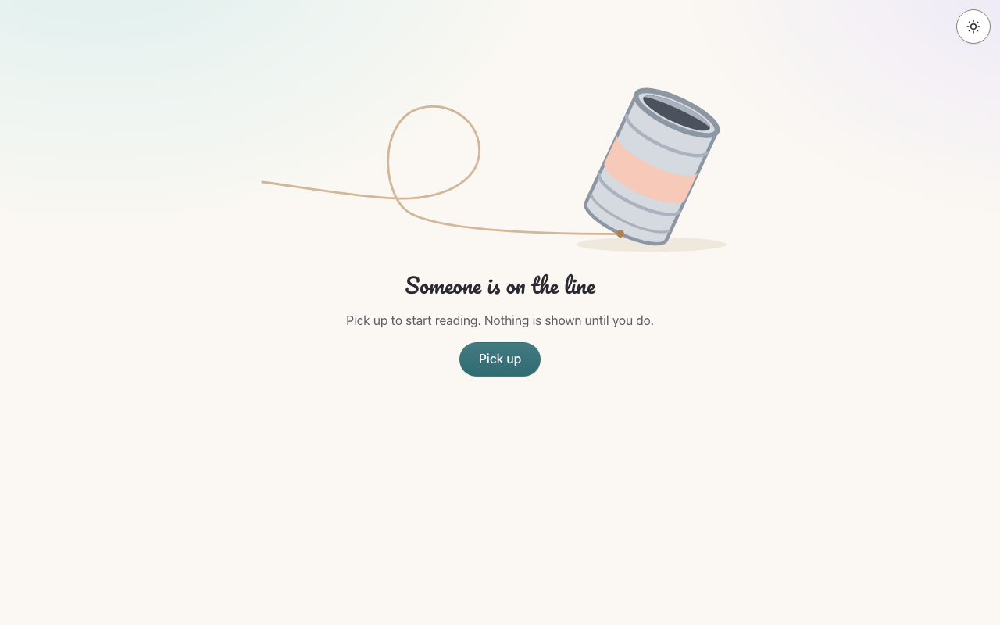
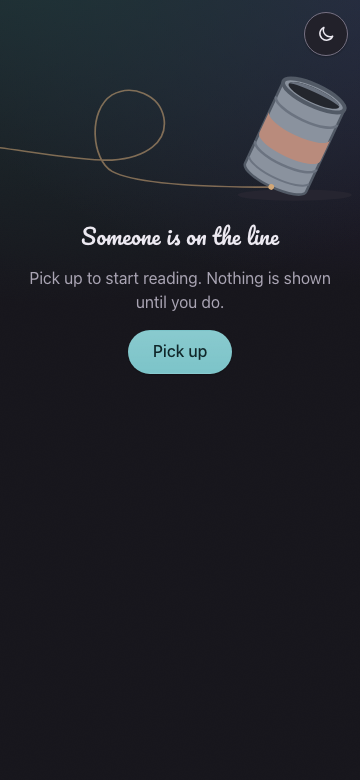
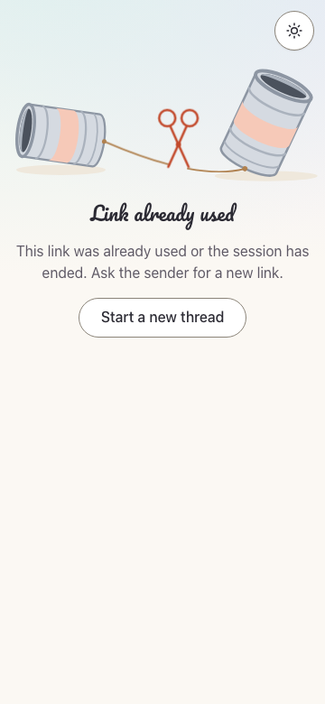

### 2. Live text, typing, beats, stale
Steps: send three consecutive texts (ASCII, unicode, multi-line with indentation), a typing message, beats every 4 s for 20 s, then silence, then a beat and a text.
Expected: exact text in order; typing hint about 3 s and cleared by the next text; beats keep it live; stale after 15 s of silence with the last text kept; live again on the next frame.
Actual: all texts exact (whitespace and newlines preserved); typing hint visible, gone after about 3 s, cleared immediately by a text; no stale during 20 s of beats; stale hint "Last update 15 s ago. They may have stepped away." appeared 15 s after the last beat with text kept; a beat cleared it and a text updated the view; empty text shows the empty state. Result: PASS
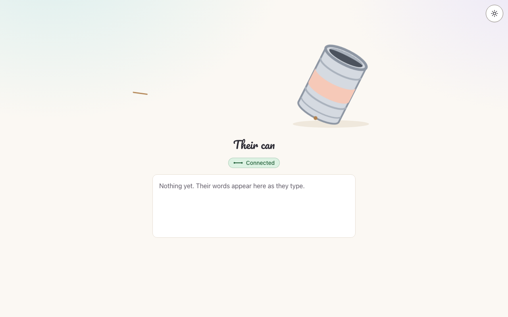
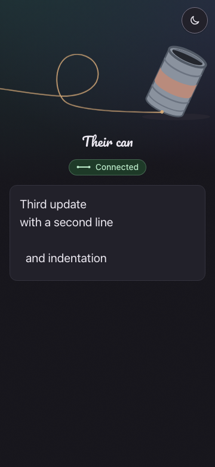
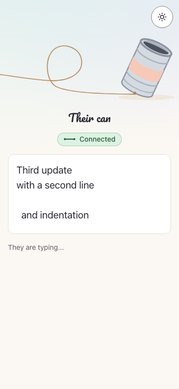
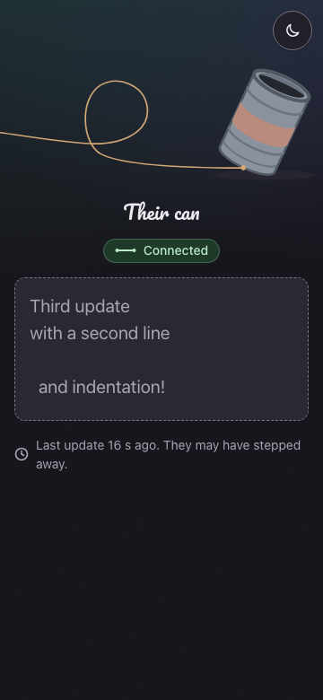

### 3. Integrity warning
Each attack was also run on a fresh receiver page to prove it alone raises the warning.
Expected: warning banner visible, last good text kept and never altered, later good frames still work, banner stays up.
Actual: tampered ciphertext, genuine old frame re-delivered by the relay (replay), frame sealed with another key, frame with another session in the AAD, frame with a renumbered AAD seq, malformed frames (bad iv/ct lengths, wrong version, not an object, garbage object): all dropped, "Something tampered with the line." shown, text unchanged. A valid frame afterwards is shown and the banner stays. Note: the honest relay itself refuses a replayed seq (`bad_request`), so replay was delivered by the proxy acting as a malicious relay. Result: PASS
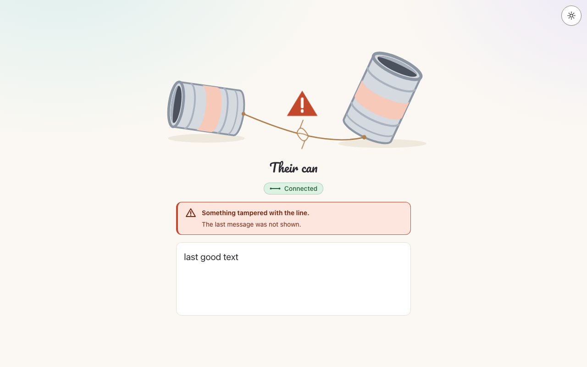
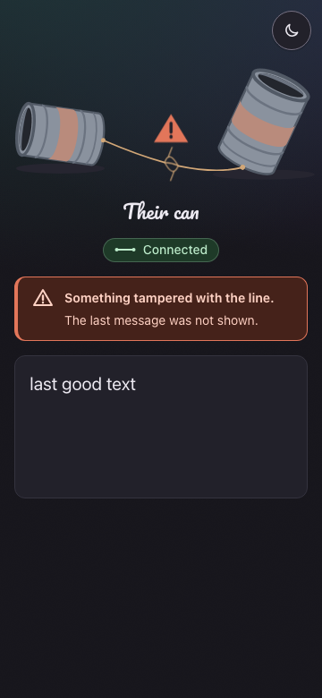

### 4. Ended
| Case | Expected | Actual | Result |
|---|---|---|---|
| Sender leaves, text received | last text readable, "The line is cut" | as expected, no typing or stale shown afterwards | PASS |
| Sender leaves, no text | line-cut screen with the hung-up message | "The sender hung up..." | PASS |
| Sender drops, text received | reconnecting, then ended at 20 s, text kept | reconnecting at 2.5 s, ended at 20.3 s, text kept | PASS |
| Sender drops, no text | line-cut screen, timeout message | "The sender lost the connection..." at about 20 s | PASS |
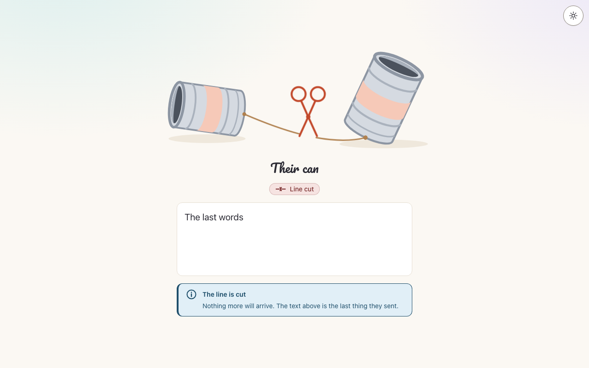
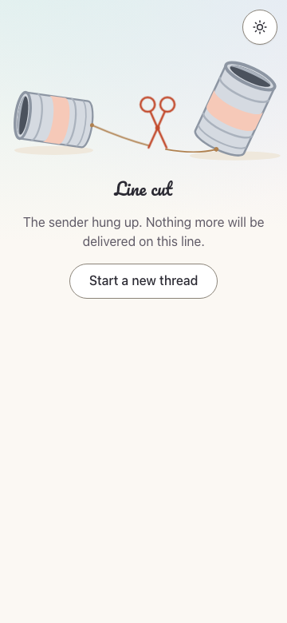

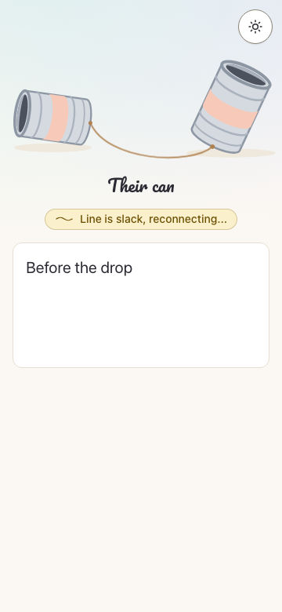

### 5. Receiver network drop and resume
Steps: proxy cuts the TCP connection for about 4.5 s, a text is sent meanwhile, connection restored.
Actual: receiver "Line is slack, reconnecting..." with text kept, sender saw `reconnecting` then `connected`, a second WebSocket was opened, the next text arrived, no integrity warning. The text sent while away is not replayed (relay behaviour, as in T07); the next text shows. Receiver away over 20 s: receiver ends with last text kept, sender gets `peer_timeout`, no revival after the network returns. Result: PASS
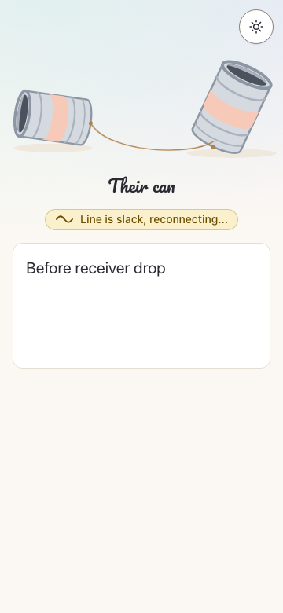

## Edge and adversarial checks
| Check | Expected | Result |
|---|---|---|
| Mangled links: `/r`, `/r/<id>/x`, bad id, short key, bad key char, long key | Invalid link, fragment cleared, no relay traffic | PASS |
| Empty fragment, missing key | Link already used, no relay traffic | PASS |
| Unknown well-formed id | "Nothing on this line" after Pick up | PASS |
| Second receiver | "This line is busy"; first receiver still gets text | PASS |
| HTML, script, `<style>`, `javascript:` link, `{{7*7}}`, entities in text | shown literally, no elements injected, no script ran | PASS |
| RTL and emoji (ZWJ sequence) | exact | PASS |
| 10 000 character text; 3000 character unbroken word and long URL | exact; no horizontal overflow at 360 and 1280 | PASS |
| 15 updates 60 ms apart | final text is the last one | PASS |
| Key in requests, post data, WebSocket frames, console, storage, cookies, title, URL, history state | absent in every run | PASS |
| CSP violations, page errors | none; the only console errors are Chromium's own "WebSocket connection failed" lines while the proxy refused connections during the drop test (same as T07) | PASS |
| Light and dark, 360 and 1280 | screens readable, no overflow | PASS |
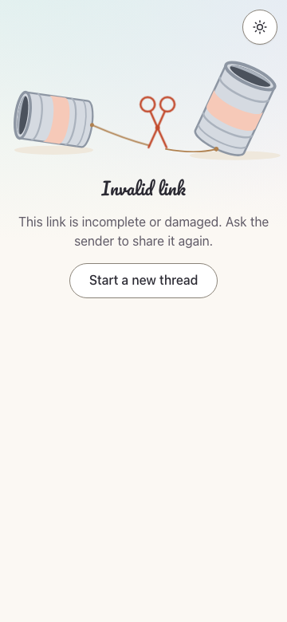
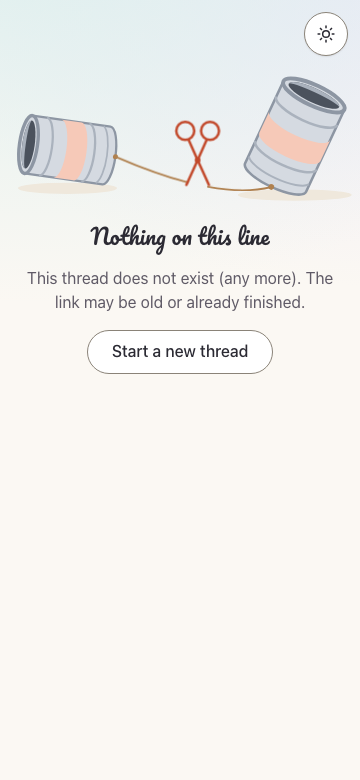
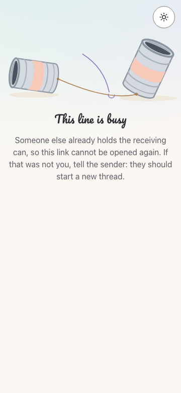
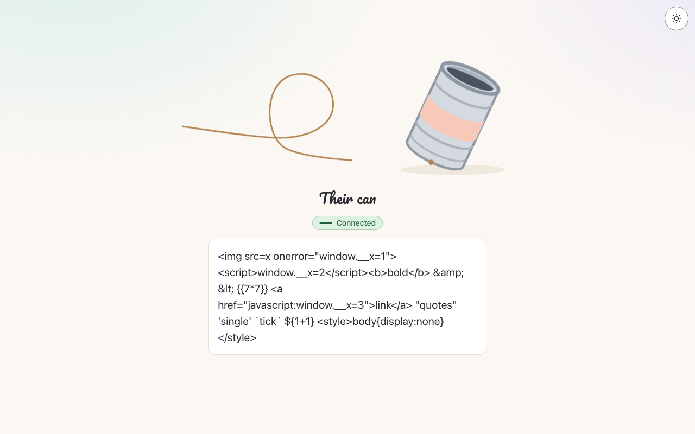
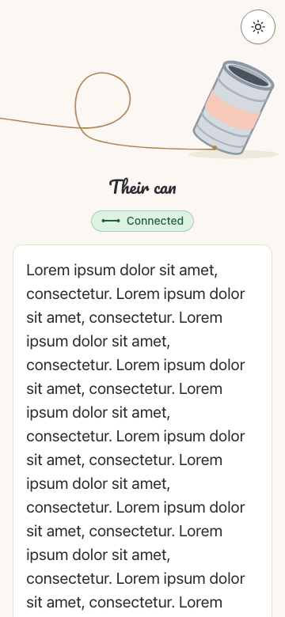

## Automated
`npm run verify` is run by the dev gate; this QA used a fresh `npm run build` of the branch. Not re-run here.

## Not covered / follow-ups
- Sender UI (T08) is not on this branch, so the sender was scripted; the full sender-to-receiver flow is T12.
- Reload of the receiver tab leaves the slot in its 20 s grace for the sender (sender saw `reconnecting`, not `peer_left`): leaving on `pagehide` is a T10 concern.
- A relay that withholds frames from the first frame on cannot be told from clock skew (documented in security.md).
- Over-limit text (more than 10 000 chars) cannot be produced by a valid sealer, so it was not sent.
- Screenshots at 1280 px dark were not kept (size); 360 px dark is included for the key states.
