# T10 test report: Disconnect, resume and staleness

| Branch | Commit | Date | Tester | Result |
|---|---|---|---|---|
| `feat/T10-lifecycle` | `c03b2a1` | 2026-11-17 | qa-tester | PASS |

## Environment
Node 24.22.3, Chromium (Playwright, headless, launched with `--enable-features=BackForwardCache`), production build, `PORT=3225 npm run serve -w @tincan/server`. Viewports 1280x800 and 360x780, light and dark.

Harness (outside the repo): the real sender UI and real receiver UI in two browser contexts, each reaching the relay through its own raw TCP proxy (sender on :3226, receiver on :3227, both forwarding to :3225). A proxy can cut every connection and refuse new ones (a real transport drop, unlike `setOffline`), or freeze (stop forwarding in both directions, keep the sockets open, refuse new connections) to simulate a half-open link. Each page recorded console errors, page errors and `securitypolicyviolation` events.

## Flows
### 1. Sender leaves
| Action | Receiver sees "Line cut" after | Last text kept | Result |
|---|---|---|---|
| Sender reload | 42 ms | yes ("first words") | PASS |
| Sender tab close | 26 ms | yes | PASS |
| Sender navigates away | 10 ms | yes | PASS |

The reloaded sender starts over from home (New thread). Receiver also shows the "The line is cut" panel with the text readable.
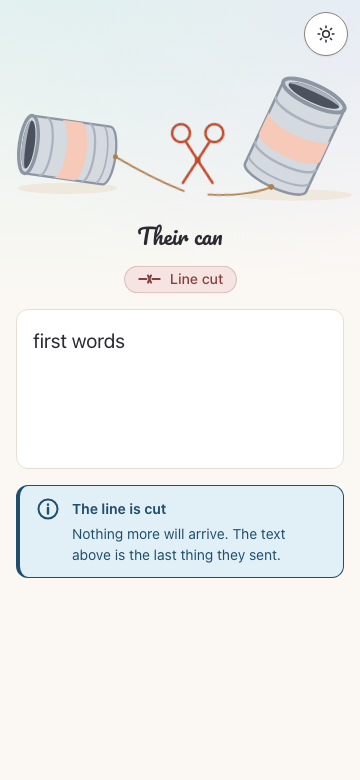
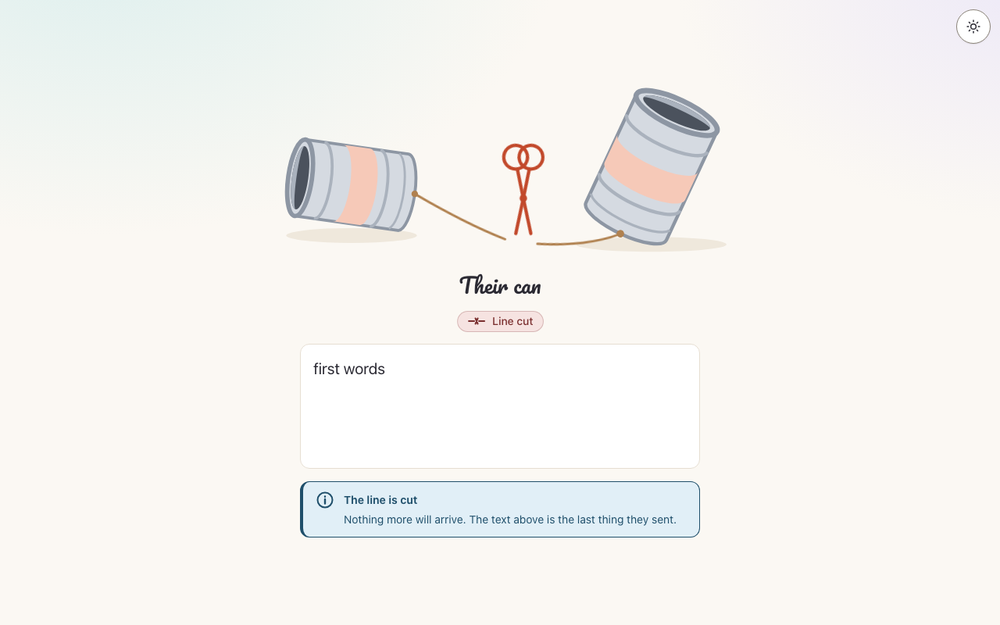
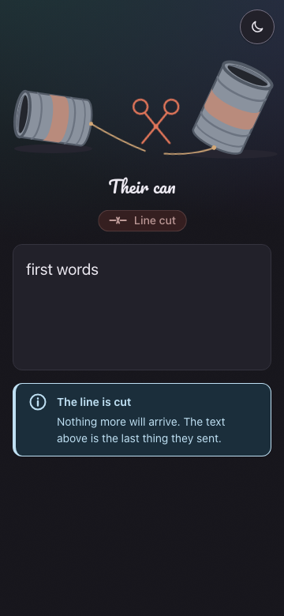

### 2. Receiver leaves
| Action | Sender sees "Line cut" after | Result |
|---|---|---|
| Receiver reload | 34 ms, textarea read-only | PASS |
| Receiver tab close | 25 ms, read-only | PASS |
| Receiver navigates away | 10 ms | PASS |

The reloaded receiver shows "Link already used".
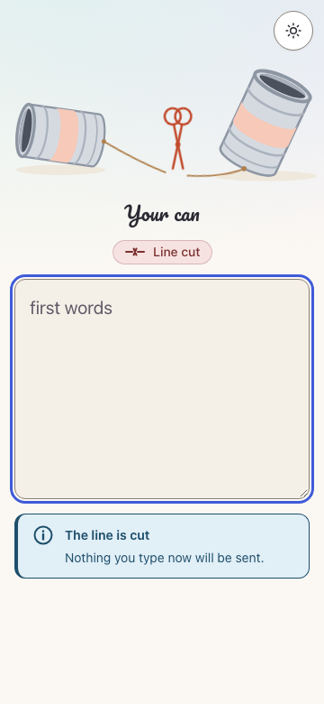
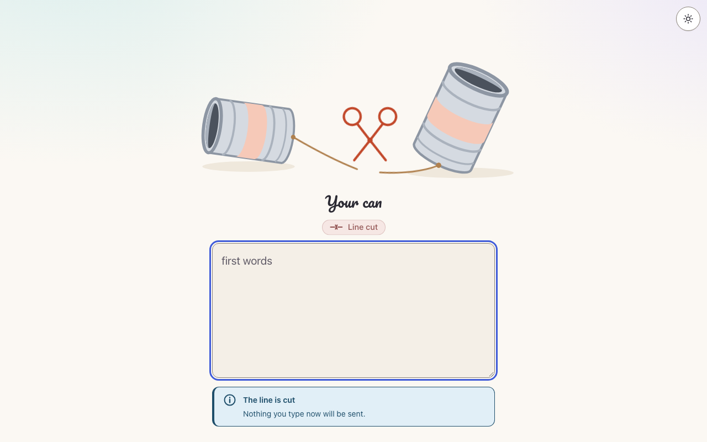
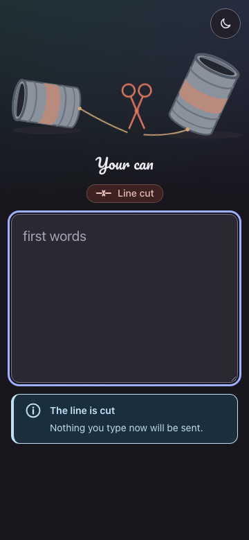
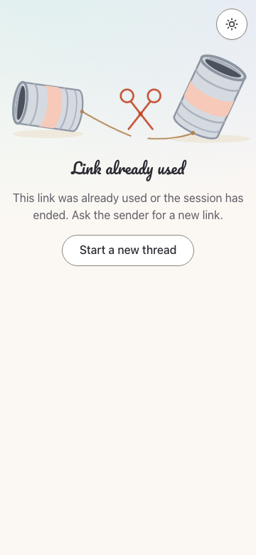
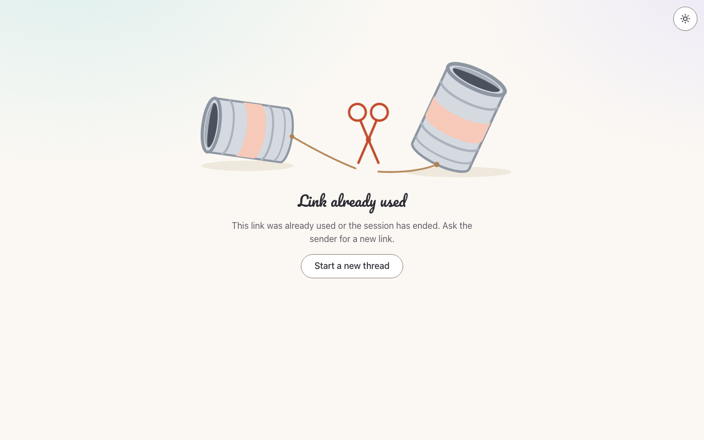
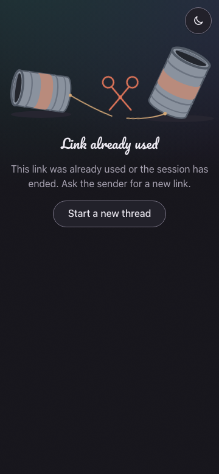

### 3. Network drop and resume
| Case | Result |
|---|---|
| Sender socket cut (4 s): sender shows "Line is slack, reconnecting..." (24 ms), receiver too (2 ms); text typed offline arrives after restore, both live again (about 6.3 s after the cut), no "Line cut" | PASS |
| Receiver socket cut (4 s): both sides reconnecting within 3 ms; text typed by the sender meanwhile arrives after restore; both live | PASS |
| Sender cut for good: receiver "Line cut" at 20.5 s, text kept; the returning sender stays "Line cut" (no revival) | PASS |
| Receiver cut for good: sender "Line cut" at 20.4 s; returning receiver stays ended with its text | PASS |

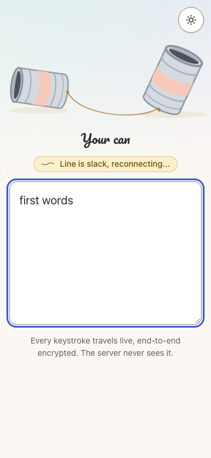
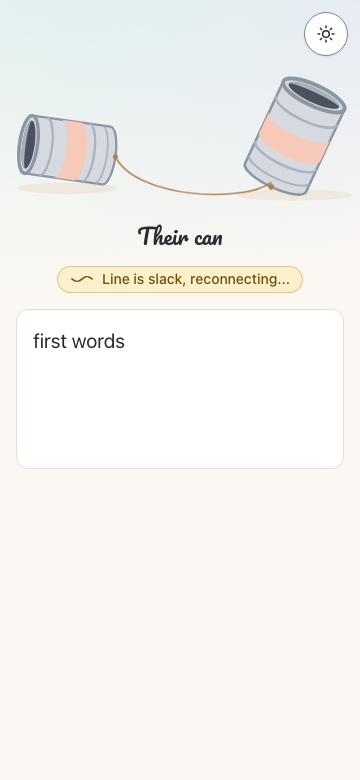
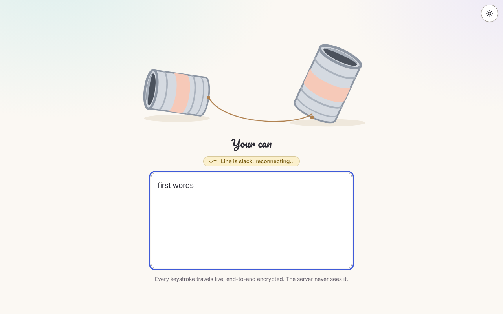
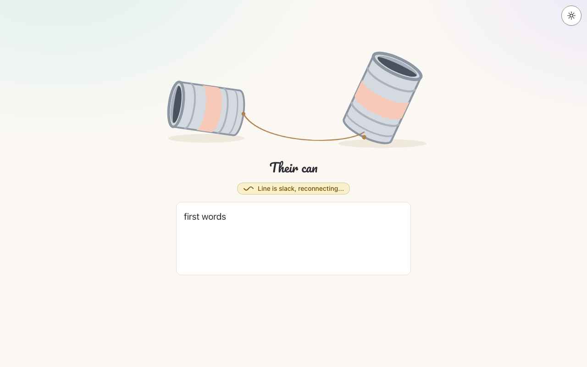
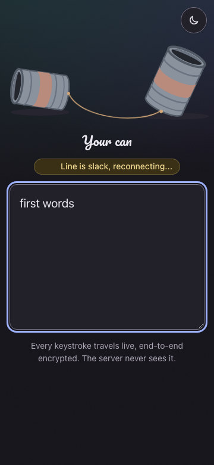
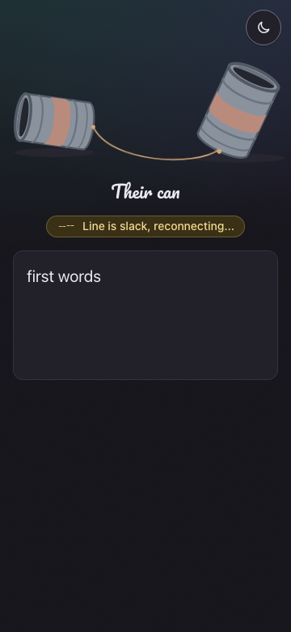

### 4. Half-open connection (peer silent, socket open)
| Silent peer | Other side shows reconnecting after | Other side ended after | Result |
|---|---|---|---|
| Sender | 13.9 s | 33.8 s (about 14 s + 20 s grace), text kept | PASS |
| Receiver | 14.4 s | 34.3 s | PASS |

Within the 15 s target (10 s ping + 5 s timeout) and well under the previous 65 s.

### 5. Back button and bfcache
bfcache could NOT be triggered: with bfcache enabled, Back after navigating away always reloaded the page (`pageshow.persisted` stayed false, in-page marker lost). The bfcache restore path is therefore covered only by the dev's unit tests, not by this QA. What was verified on the reload path:
- Receiver live, navigate away, Back: "Link already used", old text not in the DOM, no Pick up button; sender had "Line cut" within 5 s.
- Sender navigate away, Back: home screen (New thread), no stale live view, receiver ended.
- Receiver at the gate (fragment already cleared), away and Back: "Link already used", no Pick up button, sender still waiting.

### 6. visibilitychange
Both pages forced hidden (synthetic `visibilitychange` with `hidden=true`) and moved behind another tab for 25 s: session stayed live, text typed afterwards arrived, no "Line cut". PASS

## Edge and adversarial checks
| Check | Expected | Result |
|---|---|---|
| Console errors | only expected WebSocket failures during cuts | PASS: every error was `WebSocket connection ... failed` while the proxy refused connections |
| CSP violations, page errors | none | PASS (`securitypolicyviolation` never fired; no page errors) |
| Key in screenshots | none | PASS: sender screens show no link after the session starts |
| Receiver leaves within milliseconds of load (before the fragment is cleared), then Back | no key available | OBSERVATION: the history entry still carried the fragment in 1 of 2 attempts, so Back showed the gate with a working Pick up (see follow-ups) |

## Automated
Not re-run here (dev gate); `e2e/tests/lifecycle.spec.ts` exists on the branch.

## Not covered / follow-ups
- bfcache restore could not be provoked in Chromium under Playwright; unit-tested only.
- Minor race: if the receiver navigates away in the first few milliseconds after loading the link, before the app strips the fragment, the history entry keeps the key and Back re-opens the gate with a joinable link. The key is still only in the user's own history, the same as the link they opened, so this is not a regression of the lifecycle behaviour, but a dev may want to strip the fragment earlier.
- Real network loss without a TCP reset (cable pull) is only approximated by the frozen proxy.
