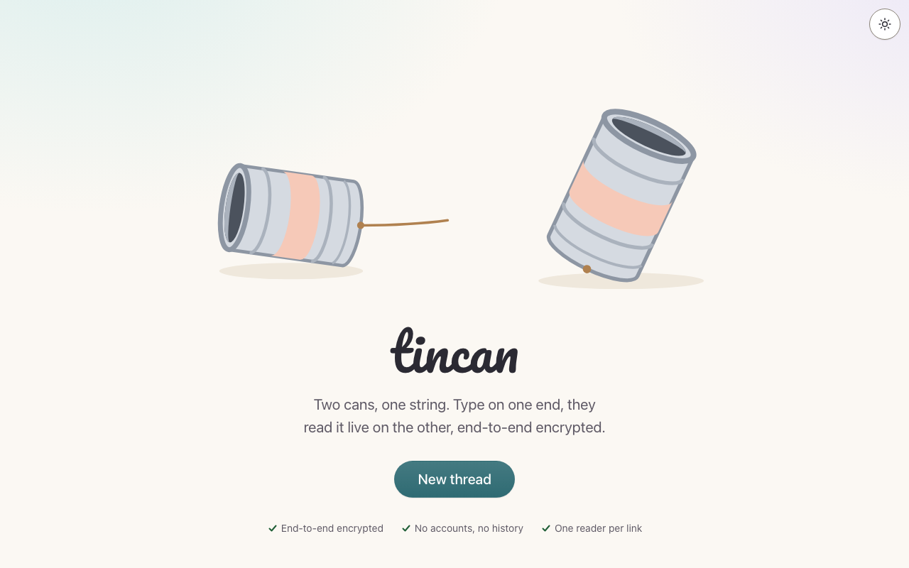
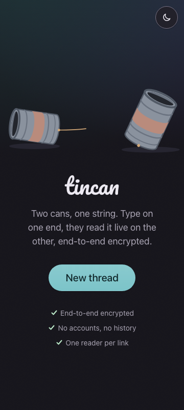
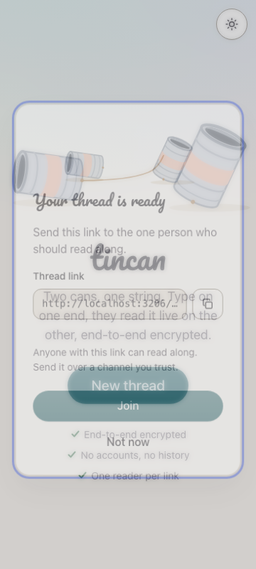
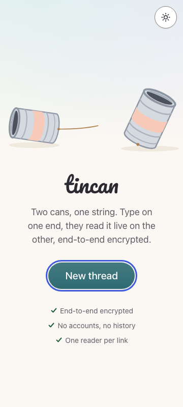
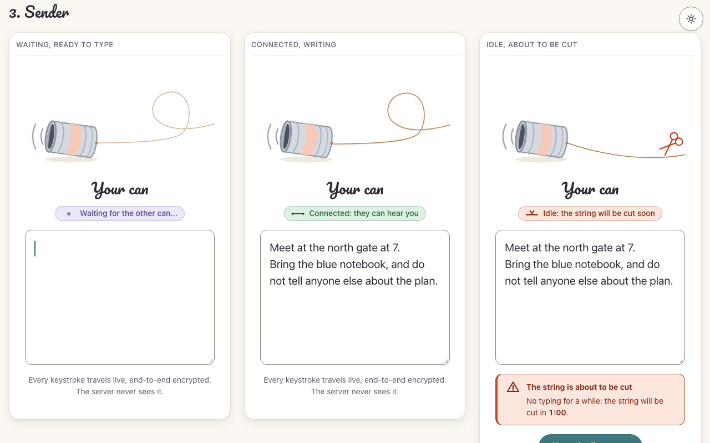
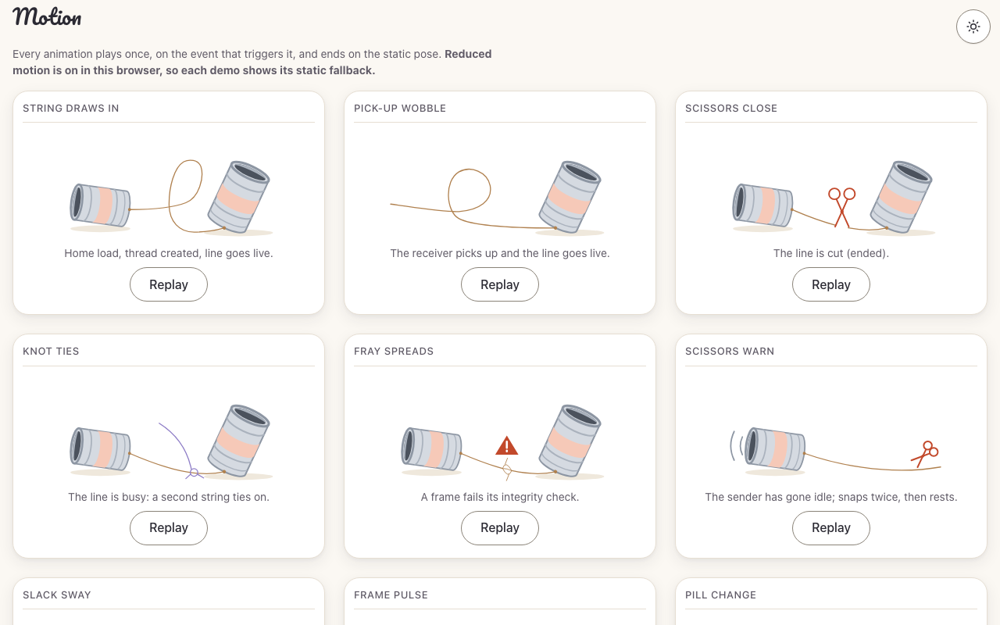

# T11 test report: Design system and logo

| Branch | Commit | Date | Tester | Result |
|---|---|---|---|---|
| `feat/T11-design-system` | `be40f58` | 2026-11-17 | qa-tester | PASS |

## Environment
Node 24.22.3, Chromium (Playwright 1.65.1, headless), production build served with `PORT=3206 npm run serve -w @tincan/server`
so the real CSP headers apply. Viewports 360x800 and 1280x800, light and dark. Scripts were throwaway and kept outside the repo.
axe-core is not installed, so contrast and structure were checked from computed styles (see flow 4).

## Flows
### 1. Home at 360 and 1280, light and dark
Steps: load `/` with `colorScheme` emulation light and dark; read overflow, `document.fonts`, console and `securitypolicyviolation`;
click the theme toggle, reload.
Expected: no horizontal overflow, Pacifico loaded, zero console errors and CSP violations, the emulated scheme is honoured, the toggle flips the theme and the choice survives a reload.
Actual: overflow 0 in all four combinations, Pacifico `loaded`, 0 errors, 0 violations; emulated dark starts dark; toggle flips `aria-pressed` and the background, `localStorage.tincan.theme` holds only the choice, and it persists after reload.  Result: PASS

### 2. New thread dialog and keyboard use
Steps: Tab to "New thread" and press Enter; Tab through the dialog; Esc; reopen and press "Not now".
Expected: dialog opens with focus inside, Tab cycles only dialog controls, Esc and the button close it, focus returns to "New thread", focus ring visible.
Actual: focus moves into the dialog; order is link input, Copy link, Join, Not now, then it leaves the page content (native modal, background inert); Esc closes and focus returns to the trigger; "Not now" closes; every control shows a 3 px solid outline.  Result: PASS

### 3. /design states and motion
Steps: load `/design` at 1280, count the figures, click all seven Replay buttons and read `document.getAnimations()`; repeat with `reducedMotion: 'reduce'`.
Expected: every sender and receiver state renders; replays animate; under reduced motion nothing animates and end states show.
Actual: 29 figures, none empty, no overflow, sender states (waiting, writing, idle, reconnecting, cut) and receiver states (pick up, live, reconnecting, stale, integrity, cut) plus busy and cut screens all present; 83 to 93 animations right after each replay; with reduce, 0 after every replay, 0 infinite, all motion SVGs visible; 0 errors and 0 CSP violations in both modes.  Result: PASS

### 4. Accessibility (manual, no axe)
Steps: for `/` and `/design` in both themes compute WCAG contrast of every visible text node against its nearest opaque background (4.5, or 3 for large text); list landmarks, unnamed buttons and links, h1 count, `lang`; read the idle `role="timer"`.
Expected: no contrast failures, one `main`, one h1, all controls named, timer present.
Actual: 0 failures in all four runs; one `main` (plus a `header` on `/design`), one h1, `lang="en"`, 0 unnamed controls; idle banner has `role="timer"` with `1:00` and no live region.  Result: PASS

## Edge and adversarial checks
| Check | Expected | Result |
|---|---|---|
| Theme toggle starting from emulated dark | flips to light, persists | PASS |
| Reduced motion: replays | 0 running animations | PASS |
| Console warnings and errors on `/`, dialog, `/design` | none | PASS |
| Mouse-opened dialog, first two Tab presses | land in the dialog | observation: they land on the page body first (Chromium focus start point); keyboard-opened dialog is fine |
| Writer caret blink under no-preference | only when motion is allowed | observation: one infinite animation (`caret-blink`), absent under reduce; docs say "all one-shot" |

## Automated
`npm run verify` was green on the branch before QA (lint, unit, build, e2e); not re-run for this docs-only commit.

## Not covered / follow-ups
No axe-core run (not a dependency). Screen reader output, Firefox and WebKit, and the real sender and receiver flows (T07, T08) are out of scope. Screenshots live in `screenshots/T11/` to match the README convention.
Open design note: the caret blink is the one non-finite animation; the designer may want to correct "all one-shot" in `docs/design.md`.
