# T16 test report: Cut the line

| Branch | Commit | Date | Tester | Result |
|---|---|---|---|---|
| `feat/T16-cut-the-line` | `2d79617` | 2026-11-17 | qa-tester | PASS for behaviour; `npm run verify` RED on one committed e2e spec (defect 1) |

## Environment
Node 24.22.3, Chromium (Playwright, headless), production build, `PORT=3262 npm run serve -w @tincan/server`. Viewports 1280x800 and 360x780, light and dark.

Harness (outside the repo): real sender UI and real receiver UI in two browser contexts. For the reconnecting cases one side reaches the relay through a raw TCP proxy that can drop every connection and refuse new ones (:3263 sender, :3264 receiver, forwarding to :3262). Page errors were recorded: none.

## Flows
### 1. Sender cuts while connected
Sender "Cut the line" asks first (nothing ended, receiver still has its own button); "Keep talking" has focus. "Cut it": receiver shows "The line is cut" after 29 ms and keeps "last words"; the sender shows "You cut the line", focus on the ended banner, the box keeps the text and is read-only (typing is ignored), no cut button, no `#` in the URL. Result: PASS
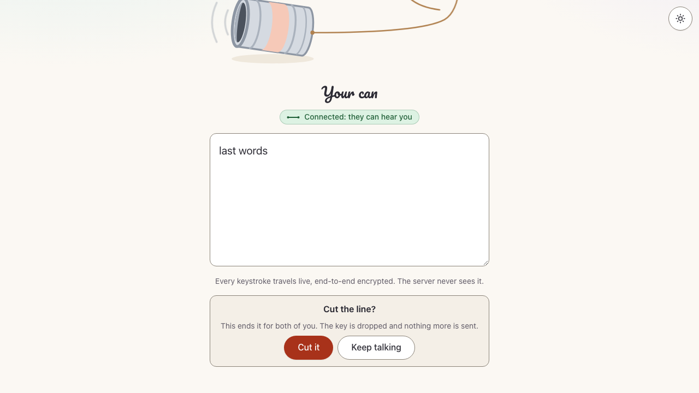
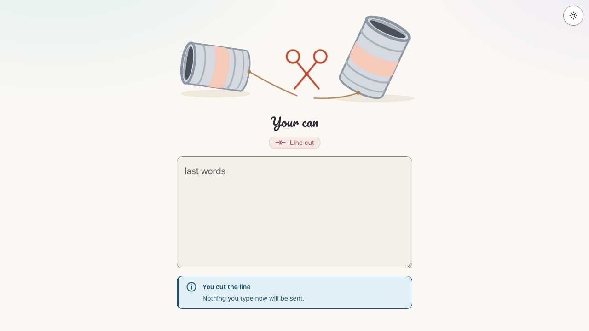
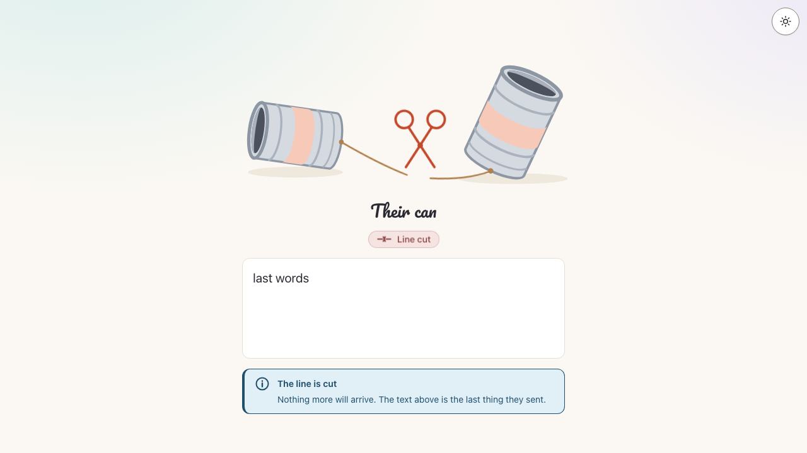

### 2. Receiver cuts
After text: sender "The line is cut" after 37 ms, read-only, text kept; receiver "You cut the line", text kept, focus on the banner. Before any text: receiver cut screen shows heading "You cut the line" with focus on the H2; sender ended. Gate has no cut button. Result: PASS
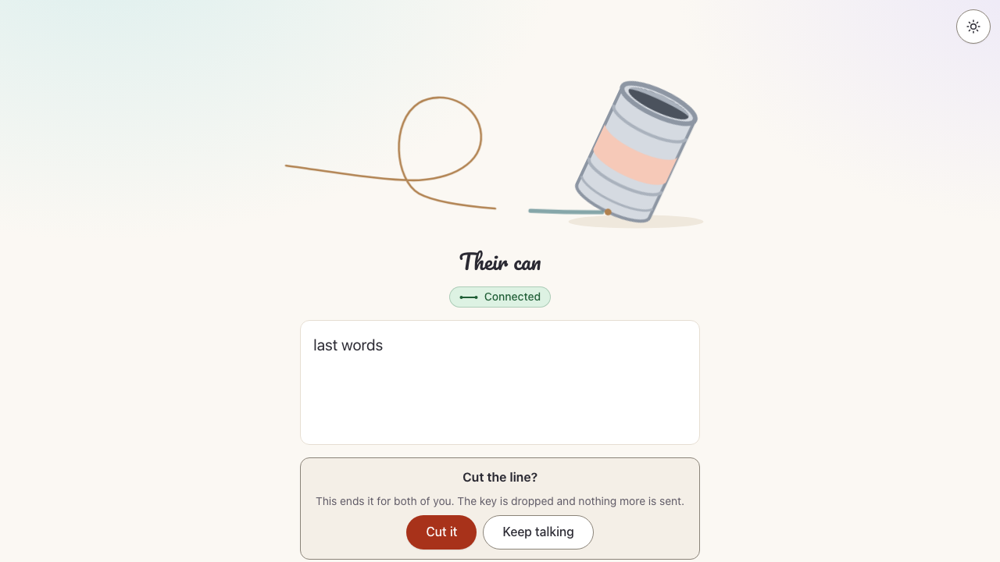

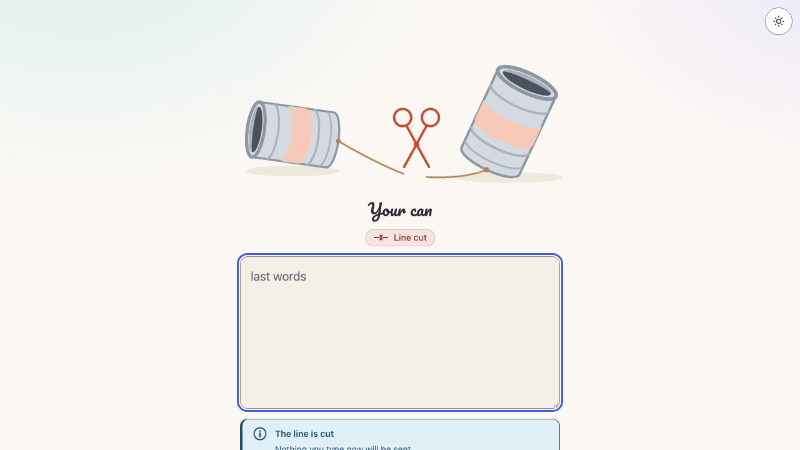

### 3. Cancel
Escape (after the question has settled) and "Keep talking" on both sides: group gone, focus back on the trigger, text still flows both ways. Result: PASS, but see defect 1 (Escape sent in the same frame as the click is lost) and observation A.

### 4. Cut while waiting for the receiver
Button present in the waiting state; cut gives "You cut the line" with focus on the banner. The old link's gate still renders, and Pick up then leads to "This thread does not exist". Result: PASS
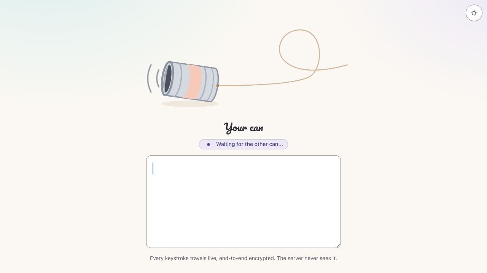
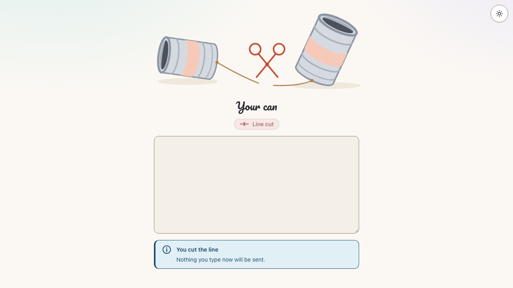
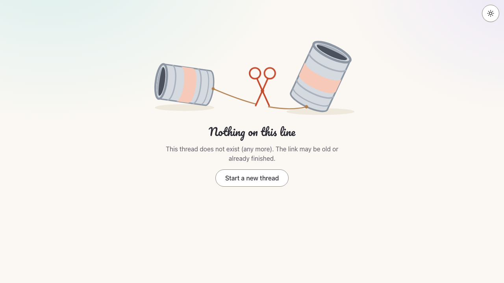

### 5. Cut while reconnecting
| Case | Local end | Peer ends | Result |
|---|---|---|---|
| Sender socket dropped, both show "Line is slack"; sender cuts; network restored at once | 78 ms, read-only, text kept | 20.0 s after the cut (not before 3 s); sender did not revive on restore | PASS |
| Receiver socket dropped; receiver cuts; network restored | 75 ms, text kept | 20.0 s | PASS |

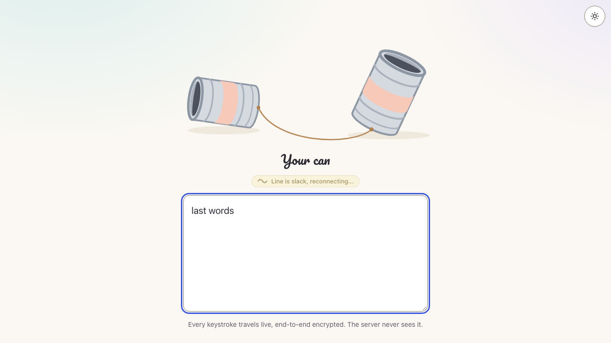

## Edge and adversarial checks
| Check | Expected | Result |
|---|---|---|
| Double click on "Cut it" | one clean cut, no error | PASS |
| Double Enter on the trigger | second Enter lands on "Keep talking": backs out, line kept | PASS |
| Reload after a cut | sender: home, no text; receiver: "Link already used", no text, no Pick up | PASS |
| Back / forward after a cut (both sides, via about:blank) | no live view, no Pick up, no text, no cut button | PASS |
| Keyboard only (Tab, Space, Enter, Shift+Tab) on both sides | reachable, Keep talking first, focus lands on banner after cut | PASS |
| 360 px, light and dark; 1280 dark | no horizontal overflow, buttons 90x44 and 141x44 | PASS |
| Escape with focus moved out of the confirm (clicked the textarea) | confirm stays open (Escape is handled on the group only) | OBSERVATION A |

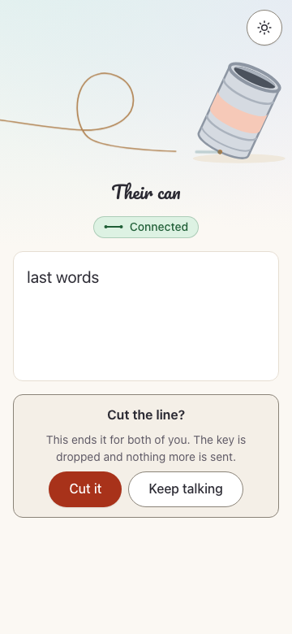
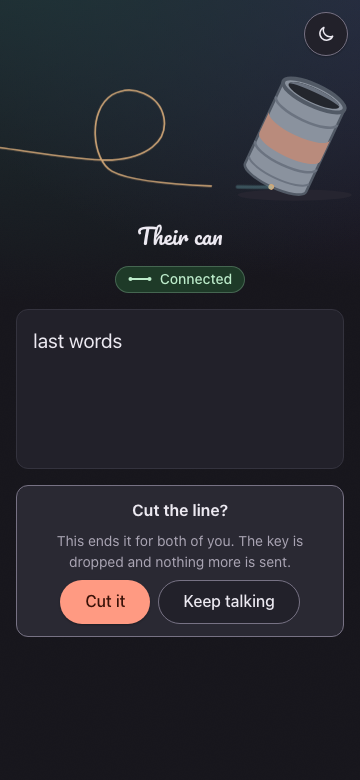
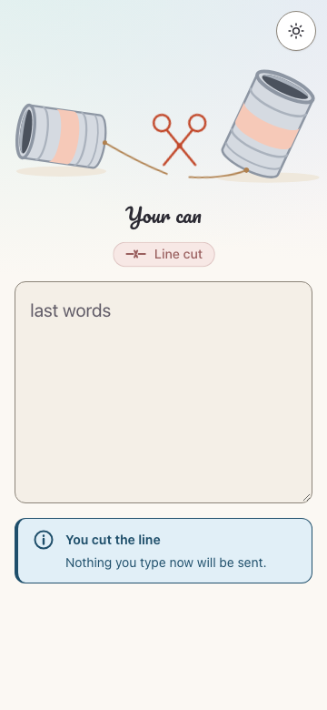
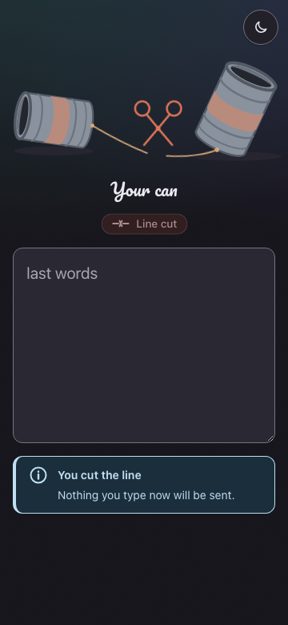
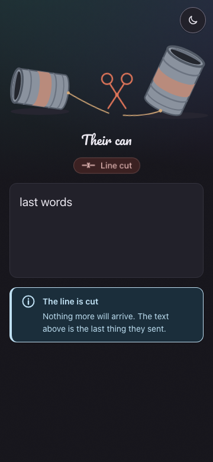

## Automated
`E2E_PORT=3261 npm run verify`: lint green, unit green (93 + 265 + 110 tests), build green, e2e 26 passed, 1 failed:
`cut-the-line.spec.ts:85 Escape and Keep talking back out without ending anything` (line 91, the confirm group is still present after Escape). Result: RED.

## Defects
1. Medium (test and robustness): Escape pressed right after the trigger click is lost. `arm()` moves focus to "Keep talking" only in `afterNextRender`; until then focus is on `body` (the trigger was removed), so `(keydown.escape)` on the group never fires, and the question stays open. Repro: click "Cut the line" and press Escape in the same tick (Playwright `click()` then `keyboard.press('Escape')`); 3 of 5 runs with no delay left the confirm open, with a 300 ms pause 0 of 3. This makes the committed spec flaky under parallel load and fails `verify`. Fix suggestion: listen for Escape on the host or document while confirming, or focus synchronously.
2. Low: the only scenario where Escape does nothing for a real user is observation A (focus moved out of the group); same fix as above covers it.

## Not covered / follow-ups
- Sender idle countdown under an open confirm (known and accepted by dev) was not exercised.
- Real network loss without a TCP reset is only approximated by the proxy.
- Three 1280 dark screenshots were dropped to stay under the 300 KB guideline; the 360 dark ones are kept.
