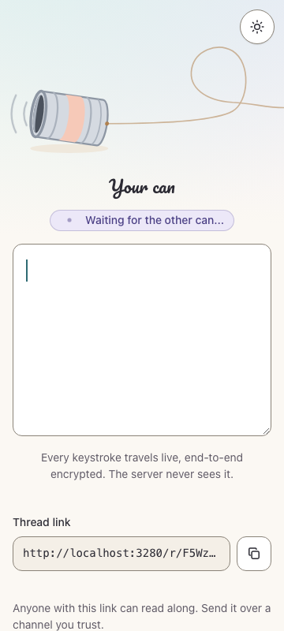
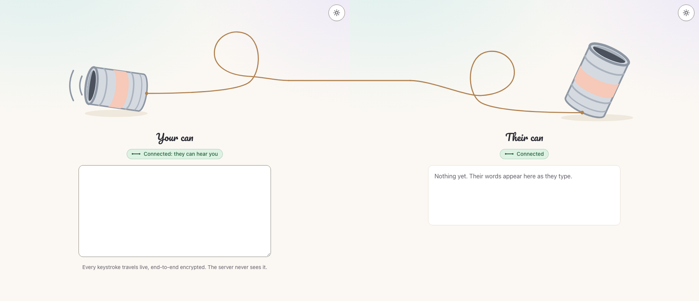
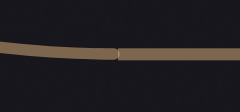
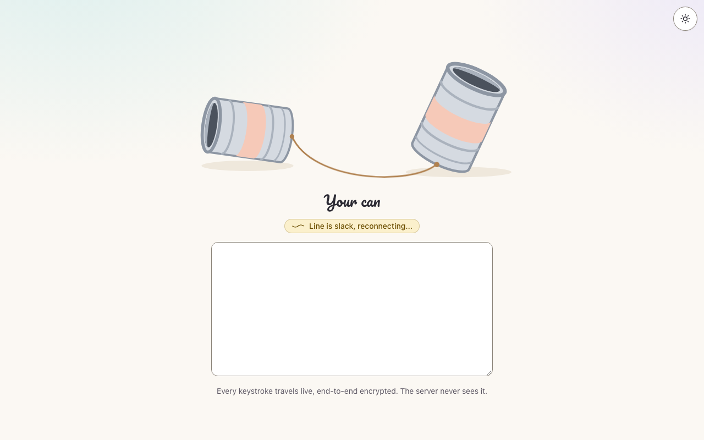
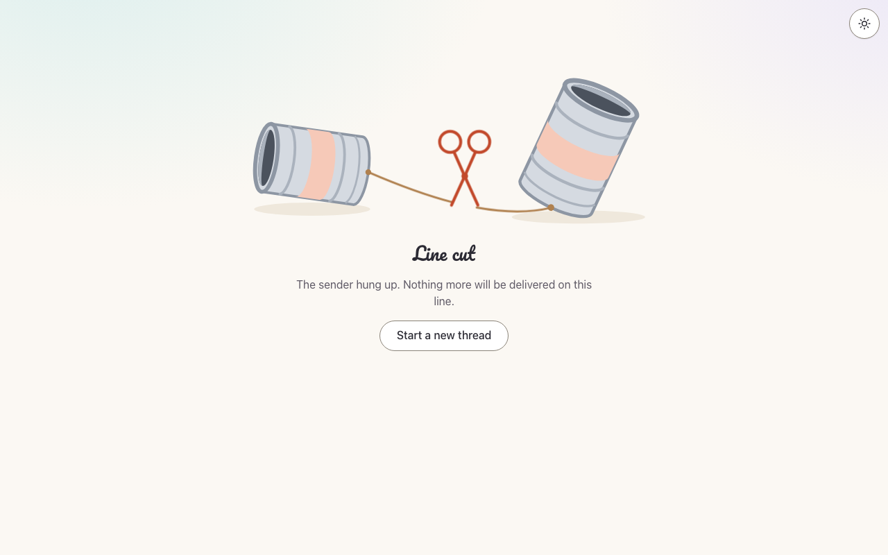
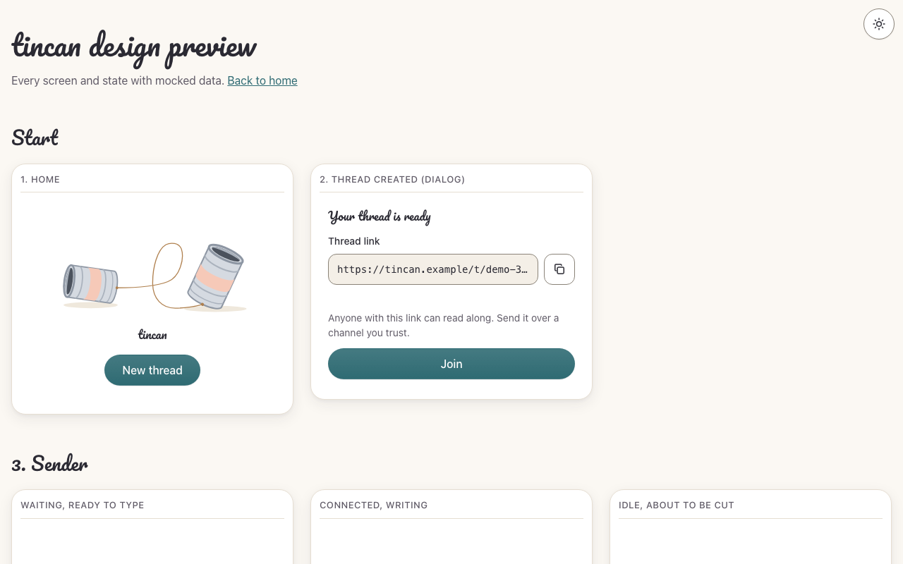

# T17 test report: String to the viewport edge

| Branch | Commit | Date | Tester | Result |
|---|---|---|---|---|
| `feat/T17-string-to-edge` | `0cad3d9` (+ T17 commits) | 2026-11-17 | qa-tester | FAIL (1 defect, see D1) |

## Environment
Node 24.22.3, Chromium (Playwright headless), production build on `npm run serve -w @tincan/server` (:3280, real CSP),
`E2E_PORT=3281 npm run verify`. Widths 360, 768, 930, 1280, 1440, 1920, height 800, light and dark. Throwaway scripts kept
outside the repo. Edge rows were measured on screenshots by diffing the edge columns with and without the tail.

## Flows
### 1. Tail reaches the edge (6 widths x 2 themes x 4 states)
Steps: sender waiting, receiver pick-up, then both connected (steady state, 9 s after draw-in); read the `.tail` rect,
`scrollWidth`, console.
Expected: sender tail right = innerWidth, receiver tail left = 0, `scrollWidth <= innerWidth`, no console errors.
Actual: connected sender/receiver: exact (right = innerWidth, left = 0 at every width), scrollWidth = innerWidth, 0 console
errors or warnings. Receiver pick-up (dimmed): left = -3.4 px (off-screen, harmless), scrollWidth fine.
**Sender waiting (dimmed): tail right = innerWidth + 3 px (e.g. 363 at 360, 933 at 930, 1923 at 1920);
`scrollWidth` = innerWidth + 3 and `scrollTo(200, 0)` moves the page 3 px.** Result: FAIL for sender waiting (D1), PASS elsewhere

### 2. Side-by-side composites 930+930 and 1280+1280
Steps: sender and receiver in two contexts at the same width, measured the string's pixel rows on the sender's last three
columns and the receiver's first three, waiting/pick-up and connected, light and dark.
Expected: same rows on both sides.  Actual: rows 212 to 215 (4 px thick) on both sides in every case, all three columns.  Result: PASS

### 3. Waiting and pick-up join, no dark dot
Steps: 4x zoom of the join between art and tail, dark and light (1280).
Expected: no darker dot where the dimmed tail meets the round cap.  Actual: no dot; a hairline seam is visible at 4x in the dimmed
state (D2, cosmetic).  Result: PASS (with observation)

### 4. Connected, reconnecting, ended
Steps: connected pair; drop the sender's socket (routed WebSocket, as in the lifecycle spec); sender reload ends the session.
Expected: connected has tails; reconnecting stays the unchanged slack picture with no tail; cut, busy and home have no tail.
Actual: connected: tails on both. Reconnecting: sender and receiver show "Line is slack, reconnecting...", 0 tails. Receiver after
sender reload: "Line cut", 0 tails. Busy screen: 0 tails.  Result: PASS

### 5. Motion
Steps: 1280, `reducedMotion` reduce and no-preference; sample the tails at 0.1 to 2.4 s; type to fire a pulse.
Expected: reduce shows the full string at once, no animation; otherwise draw-in and pulse include the tail.
Actual: reduce: tails full width from the first sample, 0 animations, string `dasharray: none`; no-preference: sender tail
width 0 until about 1.5 s, then grows to the edge; receiver tail draws first (0 to 338 px by 0.6 s); both sway
(translateY up to 3.3 px) and the sender tail gets an extra animation when a pulse fires.  Result: PASS
(Observation: the receiver tail showed no extra animation 80 ms after the sender typed; not investigated further.)

### 6. /design and accessibility
Expected: no tail on cards, tail `aria-hidden`.  Actual: 12 tails in DOM, all `display: none`, all `aria-hidden="true"`; no overflow; every
tail seen on a hero has `aria-hidden="true"`.  Result: PASS

### 7. Window resize
Steps: both pages connected, resize 1280 to 1440, 360, 1920, 768, 1280.
Expected: tail follows each time.  Actual: sender right = width and receiver left = 0 after every step; no overflow.  Result: PASS

## Edge and adversarial checks
| Check | Expected | Result |
|---|---|---|
| Console errors/warnings across all runs | none | PASS |
| CSP (no inline style) | no violations | PASS |
| Horizontal scroll, sender waiting | none | FAIL (3 px, D1) |
| Resume after restoring the dropped socket | back to connected | not observed within 8 s (relay backoff); covered by `lifecycle.spec.ts` |

## Defects
- **D1 (major, acceptance):** sender waiting, every width 360 to 1920: the dimmed tail overshoots the viewport by 3 px
  (`left: 100% + 0.75cqi/320` plus the `+2px` width), so `scrollWidth = innerWidth + 3` and the page scrolls 3 px sideways.
  Disappears in connected. Acceptance requires `scrollWidth <= innerWidth`. `body { overflow-x: clip }` does not stop it.
  Fix idea: drop the extra 2 px in the waiting variant, or clip the hero host horizontally.
- **D2 (cosmetic):** hairline seam at the art/tail join in the dimmed waiting state, visible at 4x zoom only.

## Automated
`E2E_PORT=3281 npm run verify`: lint, unit (93 + 240 + 110 tests), build, e2e (24 specs). Result: green.

## Not covered / follow-ups
Firefox and WebKit, real two-window desktop, scrollbar-bearing browsers (headless has none; `100vw` includes the scrollbar).
