# T18 test report: Receiver link as a QR code

| Branch | Commit | Date | Tester | Result |
|---|---|---|---|---|
| `feat/T18-qr-code` | `c4cb473` | 2026-11-17 | qa-tester | PASS |

## Environment
Node 24.22.3, Chromium (Playwright, headless), production build served with `PORT=3290`, two or three browser contexts per flow (sender, receiver). Viewports 360, 768, 1280, light and dark, plus reflow widths for browser zoom. Each page recorded console errors/warnings, page errors and `securitypolicyviolation` events: none.

## Flows
### 1. Toggle, default state and accessibility
Steps: create a thread, join as sender, inspect the screen, toggle by mouse, then by keyboard (Enter and Space), Tab to the button.
Expected: QR hidden by default; real button; `aria-expanded` follows state; `aria-controls` points to an existing region that holds the SVG; `aria-describedby` points to the hint text; SVG is `role="img"` with label "QR code for the receiver link".
Actual: as expected. Hint reads "Anyone who scans this can read your messages." Label switches Show/Hide, focus stays on the button after Enter/Space, button reachable with Tab. Result: PASS
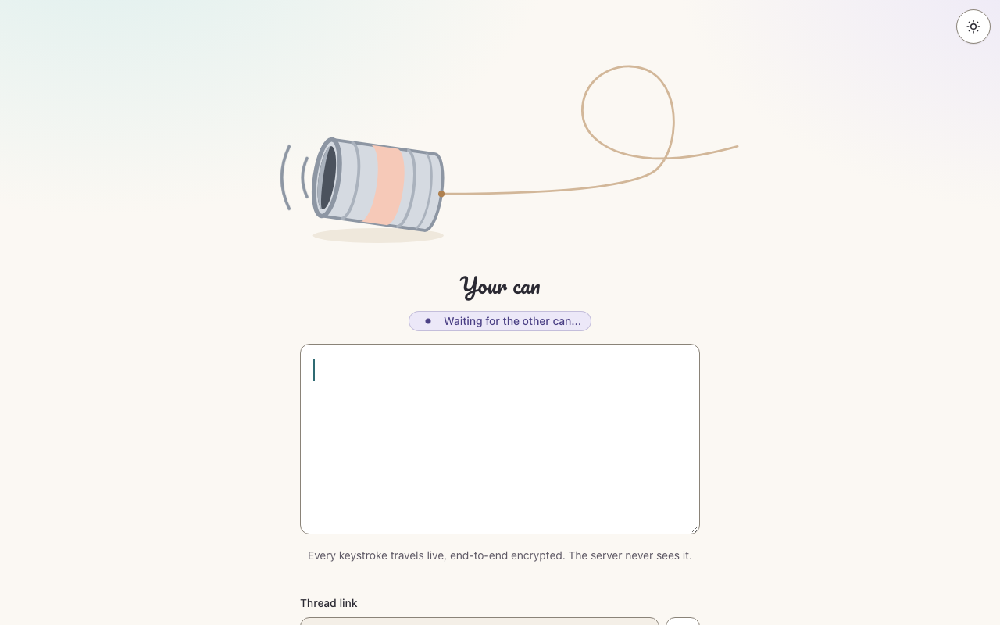
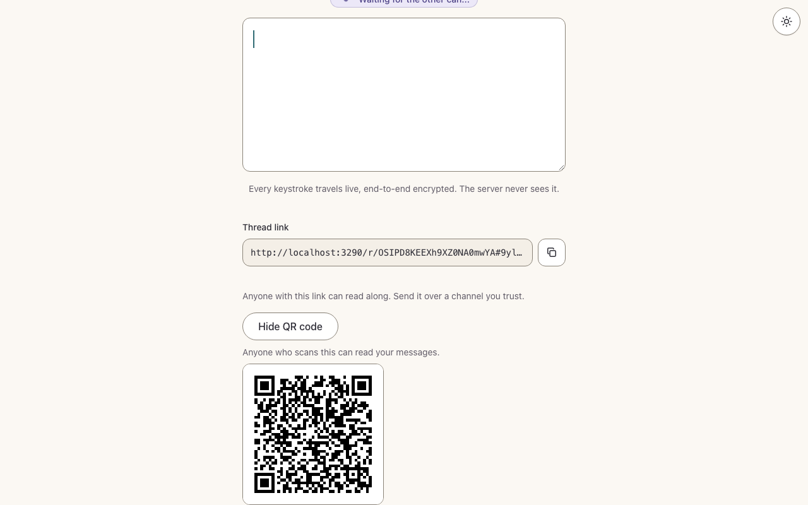

### 2. Real scan-to-use
Steps: open the QR, screenshot the SVG element, decode it with jsQR, open the decoded URL in a second context, click Pick up, type on the sender.
Expected: decoded text equals the thread link; the URL reaches the receiver gate; text arrives.
Actual: decoded value equal to the link (also at every viewport below); the gate shows Pick up; after pick-up the sender's text arrives on the receiver. The QR and its toggle vanish from the sender at pick-up. Result: PASS
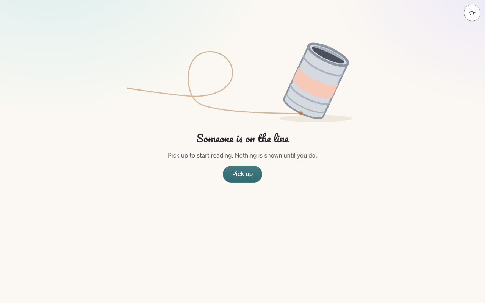
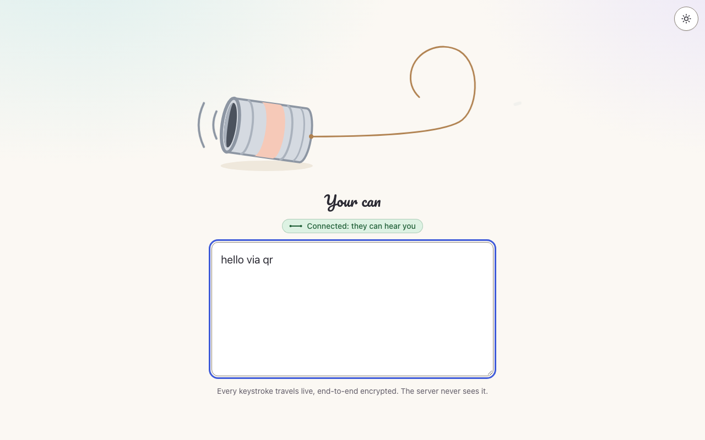

### 3. Auto-hide states
| State | QR and toggle | Result |
|---|---|---|
| Receiver connected | gone | PASS |
| Receiver left afterwards (sender shows reconnecting, then Line cut) | gone | PASS |
| Sender's own socket dropped while waiting (reconnecting) | gone | PASS |
| Sender back to waiting after reconnect | toggle returns, closed, no QR | PASS |
| Idle warning (fake clock, 9.5 min) and idle cut (10.5 min) | gone | PASS |
| Sender reload (session ended, back home) | gone | PASS |
| `/s` with no session (no link) redirects home | no toggle | PASS |

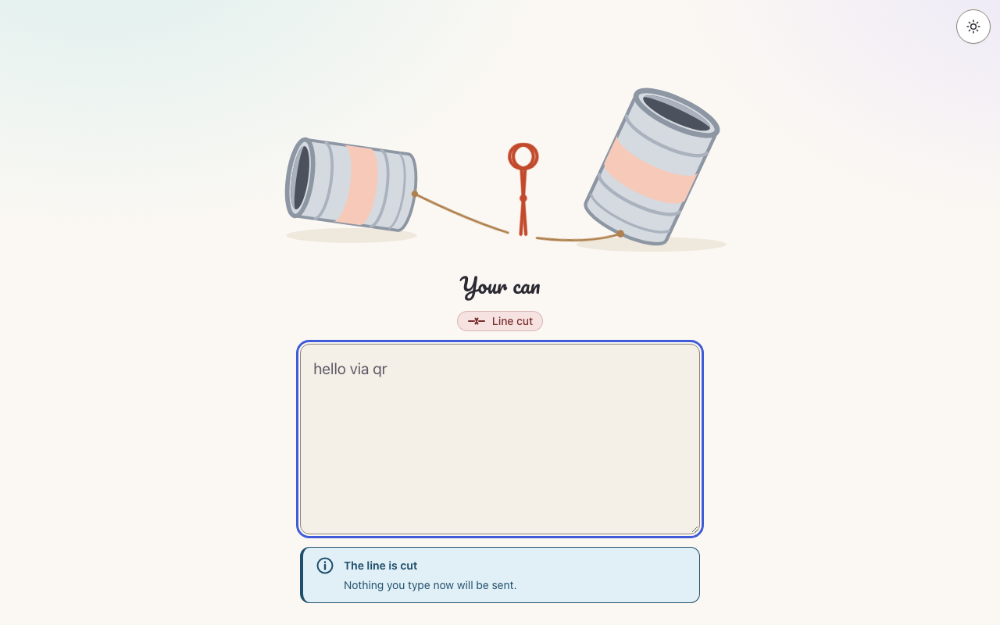
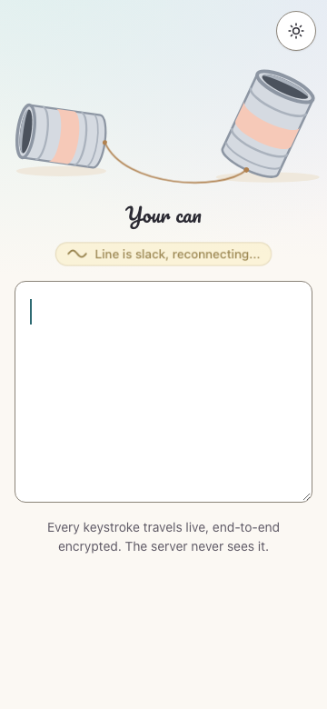
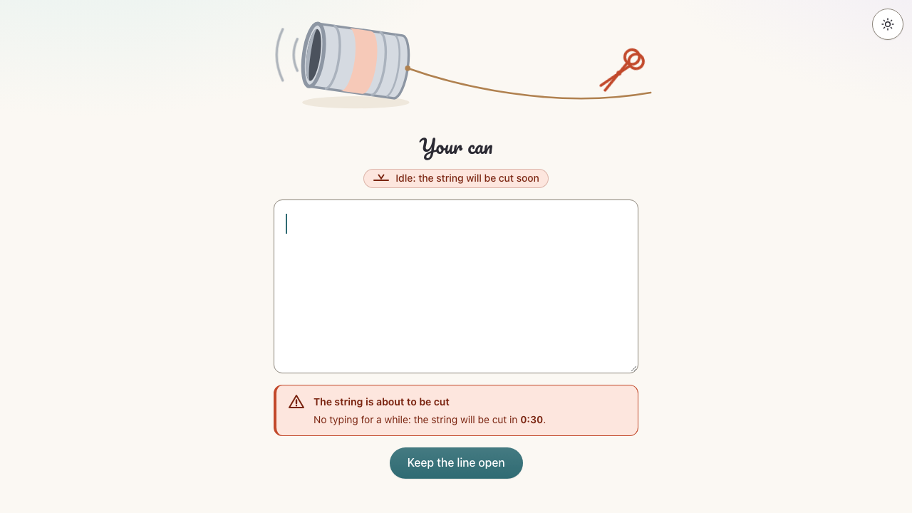

### 4. Layout, colour, zoom
| Viewport / scheme | Size | QR path / ground | Page h-scroll | Decodes to link |
|---|---|---|---|---|
| 360 light, dark | 224 px | rgb(0,0,0) on rgb(255,255,255) | no | yes |
| 768 light, dark | 224 px | same | no | yes |
| 1280 light, dark | 224 px | same | no | yes |
| 640 (1280 at 200% zoom) | 224 px | same | no | yes |
| 320 (1280 at 400% zoom) | 224 px | same | no | yes |
| 180 (360 at 200% zoom) | 224 px | same | yes (see D1) | yes |

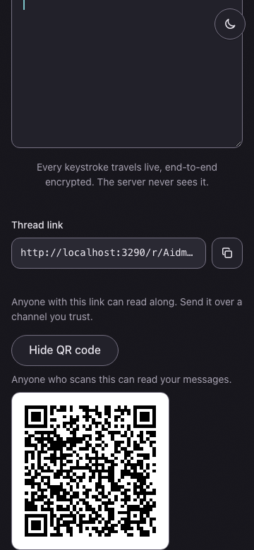
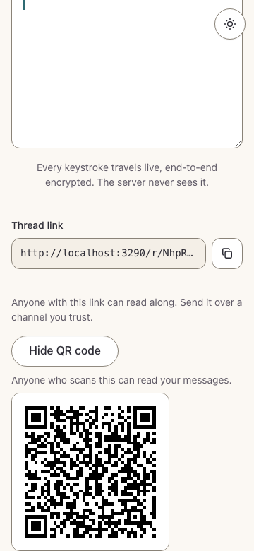
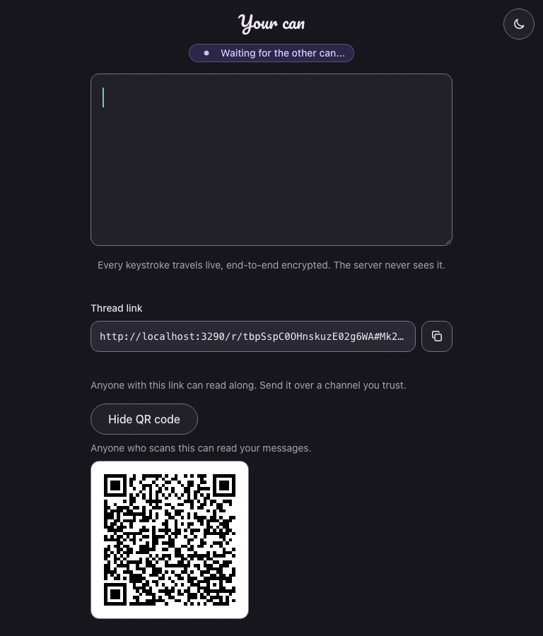
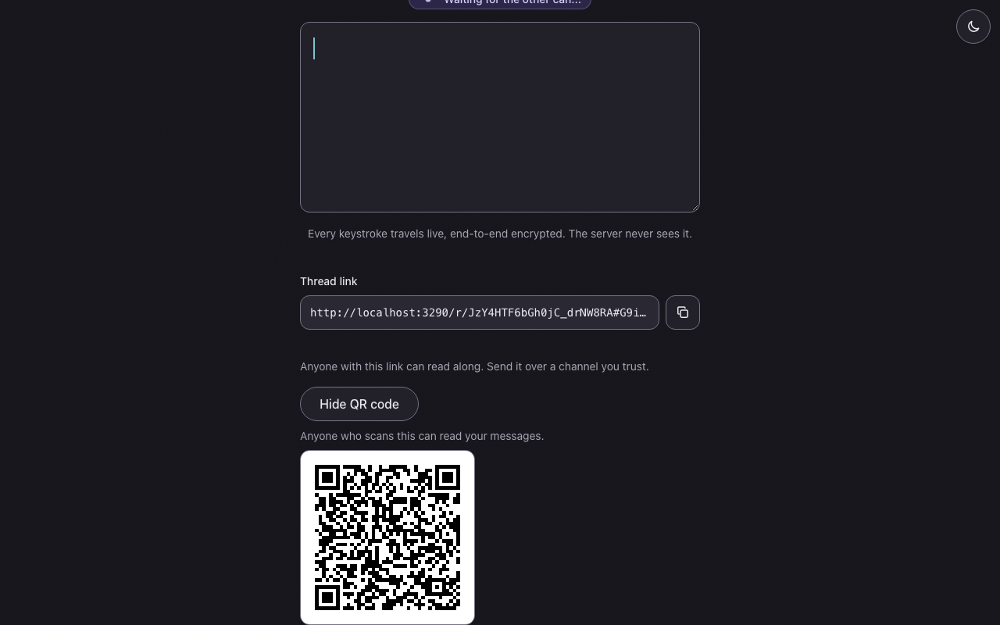
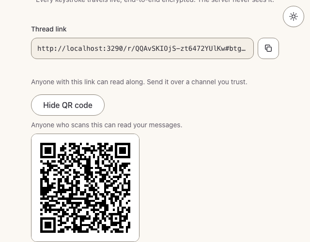

### 5. /design
The open QR figure decodes to `https://tincan.example/r/AAAA...#AAAA...` (dummy id and key), no CSP violation, no console error.
Result: PASS
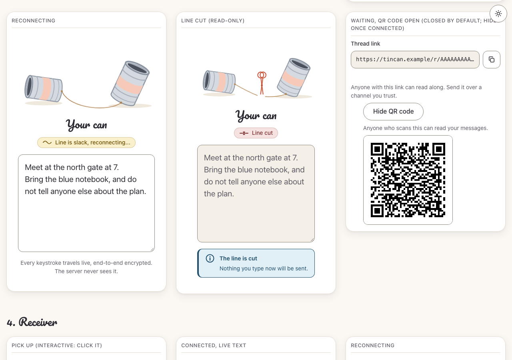

## Edge and adversarial checks
| Check | Expected | Result |
|---|---|---|
| Requests made when opening the QR | none | PASS (0) |
| CSP violations, console errors/warnings, page errors (sender, receiver, design) | none | PASS |
| `npm run test:e2e` qr spec, `--repeat-each=5` | stable | PASS (10 of 10) |

## Automated
`E2E_PORT=3291 npm run verify`: lint, unit (shared 93, client 248, server 110), build, e2e (26 specs). Result: green.

## Not covered / follow-ups
- D1 (low): at a 180 px CSS viewport (360 px at 200% zoom) the fixed 224 px QR overflows and the page scrolls horizontally. 320 px (WCAG reflow width) is fine. A `max-width: 100%` on the SVG would fix it.
- The QR stays open while waiting (accepted by security review); no auto-close.
- Scanning was simulated by decoding a screenshot, not with a phone camera.
