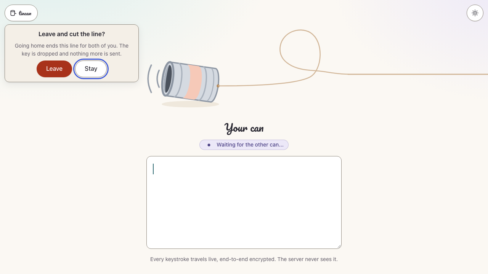
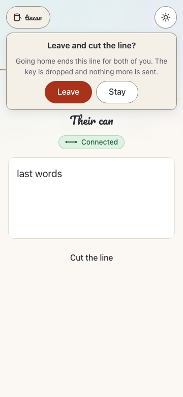
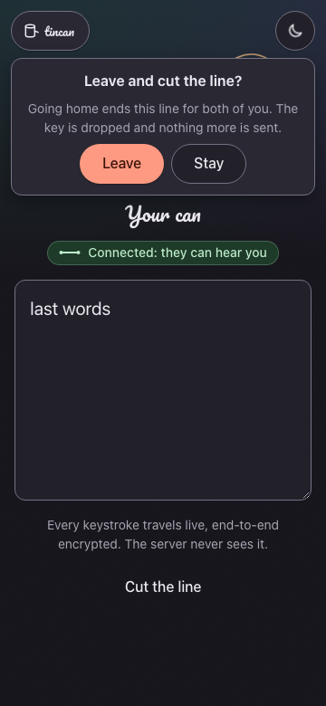
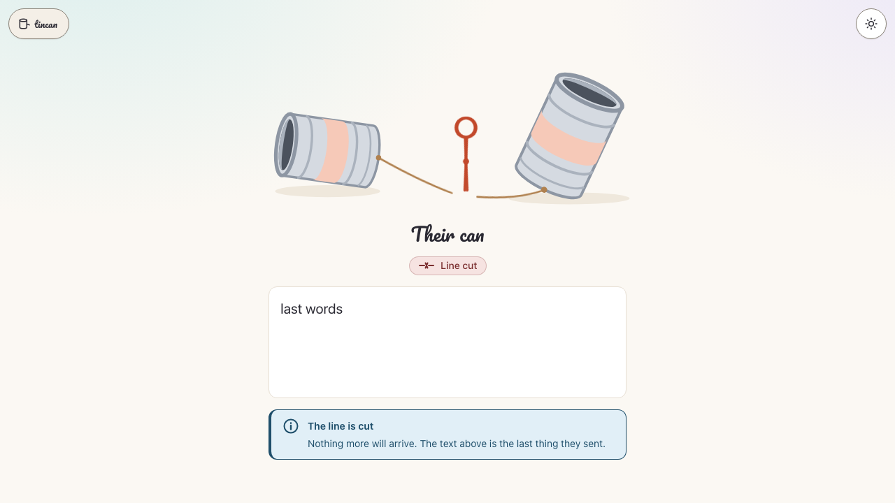
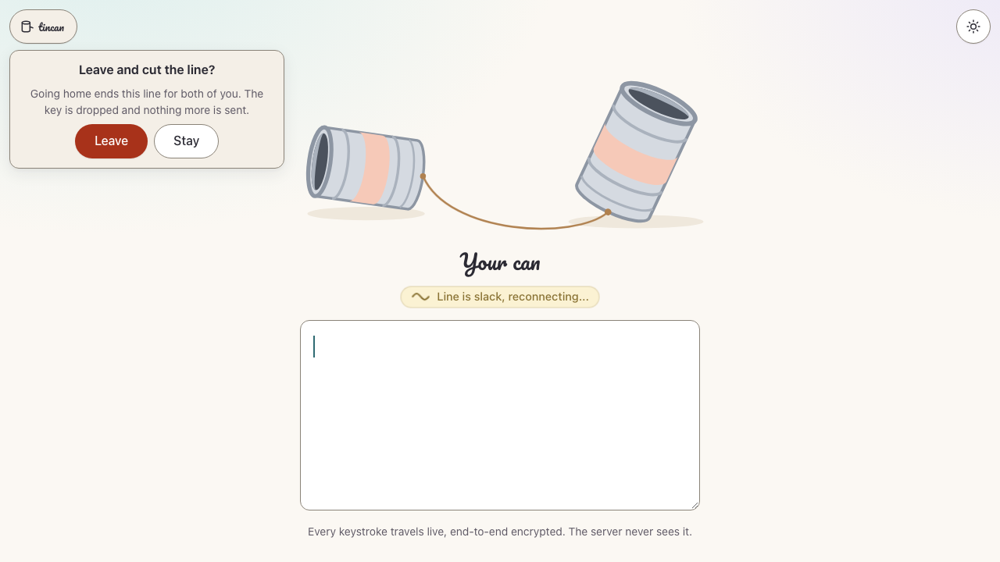
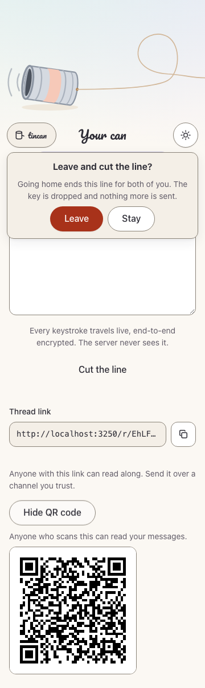
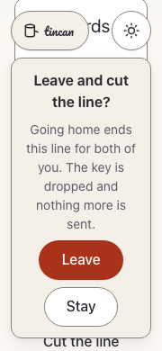
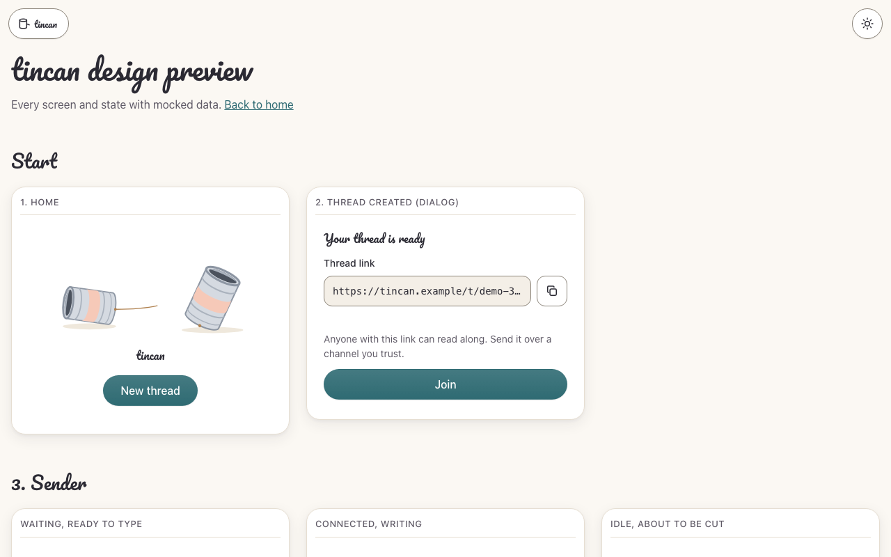

# T19 test report: A way back to the home page

| Branch | Commit | Date | Tester | Result |
|---|---|---|---|---|
| `feat/T19-home-link` | `67768c0` | 2026-11-17 | qa-tester | PASS |

## Environment
Node 24.22.3, Chromium (Playwright, headless), production build served with `PORT=3250` (real CSP), a sender context and a receiver context per flow. Viewports 360 and 1280, light and dark, plus 640 and 180 CSS px (1280 and 360 at 200% zoom). Every page recorded console errors/warnings, page errors and `securitypolicyviolation` events: none in any flow below. Reconnect cases use a routed WebSocket that is dropped and restored; the idle cut uses a fake clock fast-forwarded past 10 minutes.

## Flows
### 1. Visibility and keyboard
Steps: open `/`, `/design`, `/s`, `/r/<id>`, `/r/short`, an unknown path; Shift+Tab from the sender textarea; Enter, Tab, Escape.
Expected: no control on home; "tincan home" link (href `/`) on every other page; first in the tab order, then the theme toggle; Enter opens the question with focus on Stay; Escape closes it and returns focus to the link.
Actual: as expected (an unknown path redirects home, so no control there). The link is first in DOM and tab order; on the sender page focus starts in the textarea, so the link is one Shift+Tab-pair away (textarea, theme toggle, link). Escape also works after Tab moved focus into the textarea. Result: PASS

### 2. Every open-line state asks, every closed state goes home at once
| Page and state | Click home | Result |
|---|---|---|
| Sender waiting | asks; Leave goes home | PASS |
| Sender connected | asks; Leave ends it, receiver shows "The line is cut" in about 3 ms of polling (well under 5 s) | PASS |
| Sender idle (warning, then cut after 10 min) | asks while idle; after the cut the question is withdrawn and the cut screen shows | PASS |
| Sender reconnecting | asks (link down) | PASS |
| Receiver gate (before Pick up) | goes home at once, sender keeps waiting | PASS |
| Receiver connected | asks; Leave goes home, sender sees "The line is cut" at once | PASS |
| Receiver reconnecting | asks | PASS |
| Ended, cut, busy, invalid | goes home at once, no question | PASS |

### 3. After leaving, Back restores nothing
Sender: Leave then Back lands home; `/s` typed directly redirects home. Receiver after Leave then Back: "Link already used", the URL has no fragment, no old text and no Pick up button. Receiver who left from the gate then pressed Back: same "Link already used" in that tab (the sender is still waiting and the link still works in a fresh load). Result: PASS

### 4. Races and adversarial
| Check | Expected | Result |
|---|---|---|
| Double-click the home link | one question, no navigation | PASS |
| Question open, then press Cut the line (two questions) then Cut it | home question withdrawn, line cut for both | PASS |
| Question open, peer leaves | question withdrawn, cut screen shown | PASS |
| Receiver question open, sender cuts | question withdrawn, "The line is cut" | PASS |
| Idle cut while question open | question withdrawn, Line cut screen | PASS |
| Reload during an open question (sender) | back home, receiver sees the cut | PASS |
| Reload during an open question (receiver) | "Link already used", no fragment | PASS |
| Leave while the sender's link is down | the leave cannot be sent; receiver sees "Line cut" after the grace period, 19.9 s | PASS (expected, see follow-ups) |
| Leave while the receiver's link is down | sender sees the cut after about 20.4 s; Back says "Link already used" | PASS (same) |
| Question open during a drop, link restored, then Leave | line resumes, question still open, Leave cuts the receiver within 3 s | PASS |
| Browser Back during an open sender line | ends the line without asking (accepted by design); receiver sees the cut at once | PASS |

### 5. Layout, themes, zoom
| Viewport and scheme | Page h-scroll | Pill vs theme toggle | Textarea reachable (hit test) |
|---|---|---|---|
| 360 light, dark (connected, question open, both sides) | no | clear (pill 12-99 px, toggle 304-348 px) | yes with the question closed |
| 1280 light, dark | no | clear | yes |
| 640 (1280 at 200%) | no | clear | n/a |
| 180 (360 at 200%) | no | clear | question covers most of the screen but fits, dismissible |
| 360 with the QR open and with the question open on top | no | clear | n/a |
The 2.75 rem pill matches the toggle in both schemes, the focus ring is visible, and the question card spans the viewport minus the gutters at 360 and about 22 rem at 1280. The T17 string tail still reaches the edge (e2e `string-edge` passes) and the T18 QR panel is unchanged beneath the pill.

### 6. /design
Shows the pill and the open question, no console error or CSP violation, no horizontal scroll at 360 or 1280.

## Edge and adversarial checks
| Check | Expected | Result |
|---|---|---|
| Console errors, warnings, page errors, CSP violations (all flows) | none | PASS |
| Home link on `/` | absent | PASS |
| Third context after Pick up | "This line is busy", home at once, the live line unaffected | PASS |

## Automated
`E2E_PORT=3251 npm run verify`: lint, unit (shared 93, client 308, server 111), build, e2e (37 specs). Result: green, exit 0.
`cd e2e && E2E_PORT=3251 npx playwright test --repeat-each=10 tests/home-link.spec.ts`: 50 of 50 passed.

## Not covered / follow-ups
No defects found. Observations, none blocking:
- A leave while the user's own connection is already down cannot reach the server, so the peer sees the cut after the 20 s grace (19.9 s measured), not at once. Same as closing the tab in that state.
- The open question overlays the top of the line (status pill and the first lines of the text area) at 360 px and in narrow zoom; it is dismissible and does not break layout.
- Pre-existing, unrelated to T19: reopening an old link in a fresh load after the line was cut shows the Pick up gate, and Pick up then says "Nothing on this line" (same after a plain tab close).
- The question is not held for browser Back or Forward by design.
